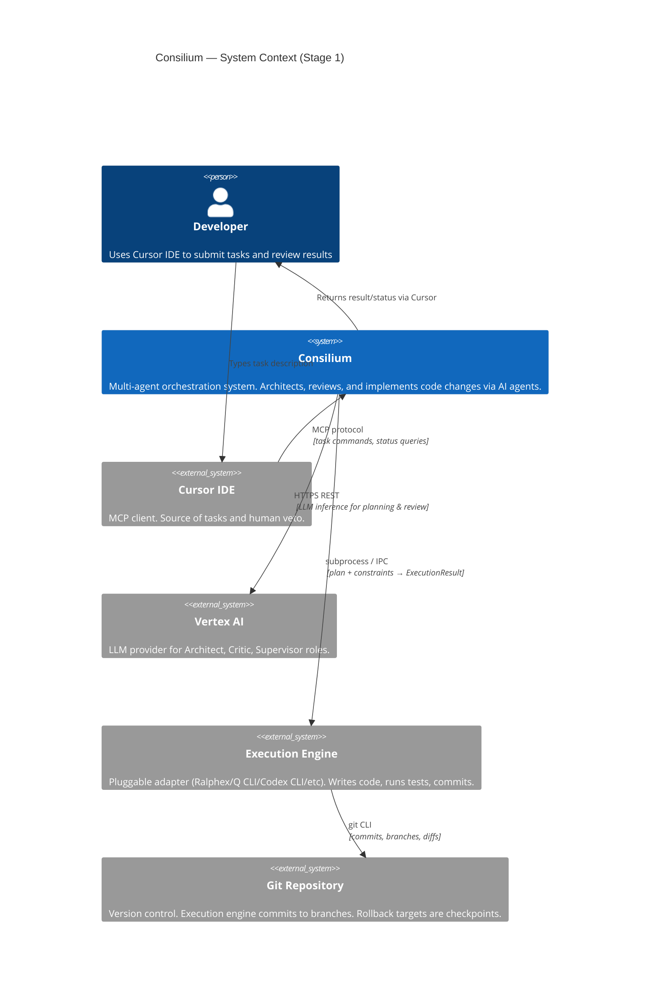
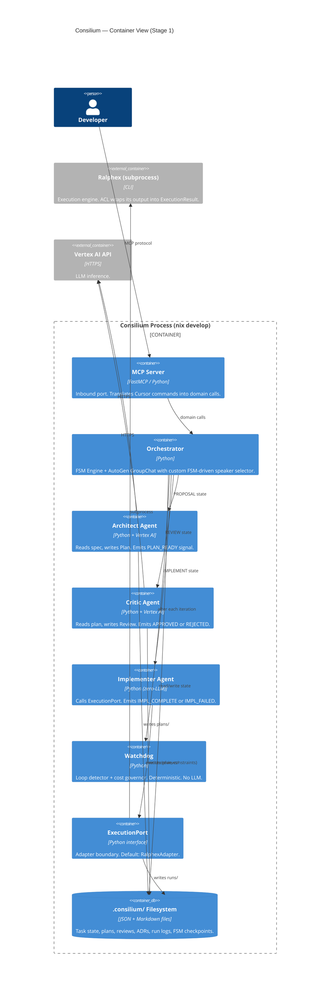
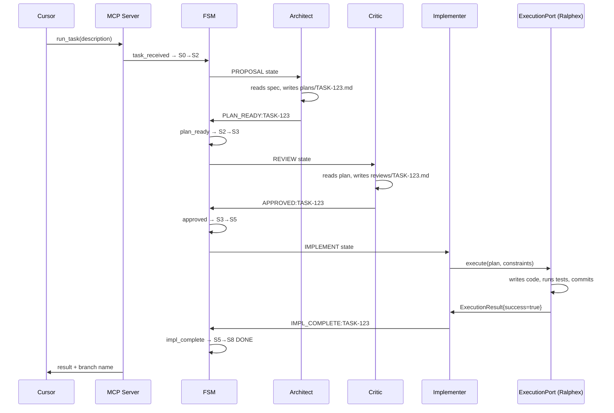
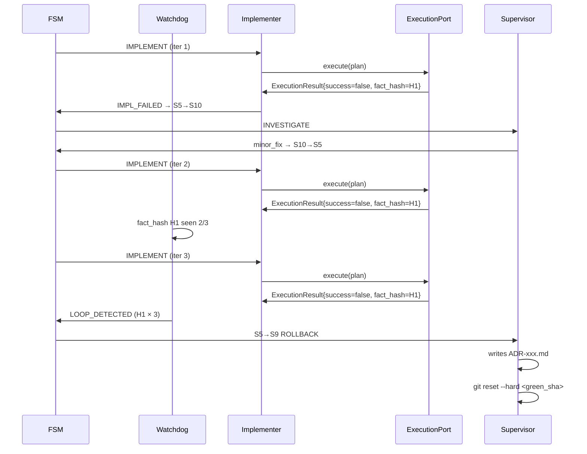
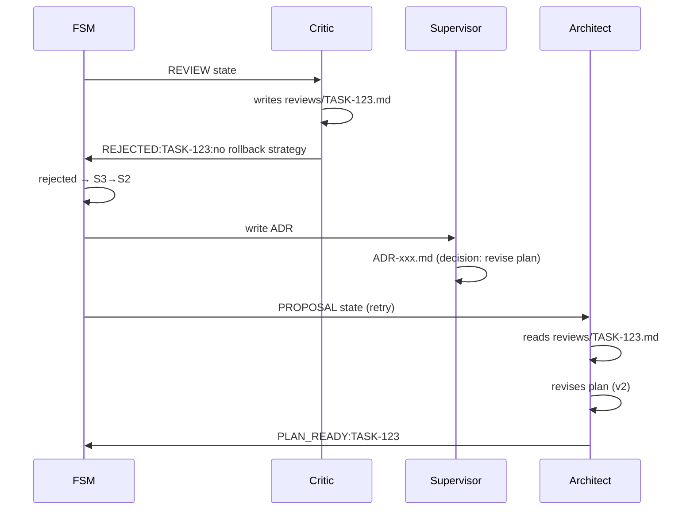

> **Standard:** Arc42-inspired + C4 Model (Mermaid diagrams) + ADR
> **Status:** Living document — updated iteratively across stages
> **Languages:** Python (MVP → Stage 2), Rust (Stage 3+ for FSM core, policy engine)
> **Current focus:** Stage 1 (MVP)

---

# PART I — UBIQUITOUS LANGUAGE

*The only true invariant across all stages.*

## Terms

| Term | Definition |
|---|---|
| **Task** | A unit of work submitted by the user. Has a lifecycle from Intake to Done or Rollback. |
| **Plan** | A structured technical proposal produced by the Architect. Describes objectives, file breakdown, steps, risks. |
| **Verdict** | A typed decision by the Critic: `Approved` or `Rejected(reason)`. |
| **ADR** | Architecture Decision Record. Append-only entry in the Decision Log. Records context, decision, rationale, consequences. |
| **FSM** | Finite State Machine. The deterministic engine governing Task lifecycle transitions. |
| **Guard** | A predicate evaluated before an FSM transition. If false — transition is blocked. |
| **ExecutionResult** | The structured output of an Execution Engine run: commits, metrics, findings, run_dir. |
| **Decision Log** | Append-only ledger of all ADRs. Immutable. The canonical record of *why* decisions were made. |
| **Canonical Memory** | Long-term knowledge base: ADRs + architectural facts. Survives between tasks. |
| **Working Memory** | Short-lived context for the current task. Scoped to one Task lifecycle. |
| **Policy** | A set of rules governing what agents are allowed to do. Versioned and auditable. |
| **Loop** | Pathological state: Implementer repeats the same failing patch. Detected by hashing facts. |
| **Green Checkpoint** | A point where all verify gates pass. The rollback target (git SHA in Stage 1; ZFS snapshot in Stage 3+). |
| **Verify Gate** | Pass/fail condition: tests green + lint clean + build passes. |
| **Progress Heuristic** | Convergence signal: are failing tests decreasing? Is diff size shrinking? |
| **ModelConfig** | A per-role configuration of LLM provider, model name, temperature, and token budget. **Roles are not hardcoded to models.** |
| **ExecutionPort** | The hexagonal port abstraction for execution engines. Any adapter (Ralphex, Q CLI, Codex CLI, direct API) plugs in here. |
| **AntiCorruptionLayer (ACL)** | A translation boundary between external system semantics and the Consilium domain model. |

---

## Roles

All roles that exist across the full system. Stages define which roles are active at each stage.

| Role | Type | Responsibility | Active from |
|---|---|---|---|
| **Human** | Principal | Final veto authority. Provides constraints, budget, GO/NO-GO on release. | Stage 1 |
| **Supervisor** | Meta-agent | FSM owner, orchestrator, ADR writer. Makes final decisions when agents disagree. | Stage 1 |
| **Architect** | LLM agent | Proposes plans, reasons about trade-offs, drafts ADRs. Never writes code. | Stage 1 |
| **Implementer** | LLM/exec agent | Executes plans via ExecutionPort. Writes diffs. Does not reason about architecture. | Stage 1 |
| **Critic** | LLM agent | Reviews plans and diagnoses failures. Adversarial by design. | Stage 1 |
| **Security** | LLM agent | Threat modelling, abuse cases, least-privilege guards, constraint injection. | Stage 2 |
| **Production Realist** | LLM agent | SLO review, rollback feasibility, operational risk, runbook requirements. | Stage 2 |
| **Tech Writer** | LLM agent (async) | Decision log, roadmap, Asciidoc/Markdown doc updates. Async observer. | Stage 2 |
| **R&D Engineer** | LLM agent (async) | Research retrieval, technology memos, daily feed of relevant findings. | Stage 3 |
| **Watchdog** | System agent | Loop detector, cost governor, invariant checker. Not an LLM — pure deterministic logic. | Stage 1 (partial) |

### Role activation per stage

| Role | Stage 1 MVP | Stage 2 | Stage 3 | Stage 4 |
|---|---|---|---|---|
| Human | ✅ | ✅ | ✅ | ✅ |
| Supervisor | ✅ | ✅ | ✅ | ✅ |
| Architect | ✅ | ✅ | ✅ | ✅ |
| Implementer | ✅ | ✅ | ✅ | ✅ |
| Critic | ✅ | ✅ | ✅ | ✅ |
| Security | ❌ | ✅ | ✅ | ✅ |
| Production Realist | ❌ | ✅ | ✅ | ✅ |
| Tech Writer | ❌ | ✅ (async) | ✅ | ✅ |
| R&D Engineer | ❌ | ❌ | ✅ (async) | ✅ |
| Watchdog | ⚡ partial | ✅ | ✅ | ✅ |

---

## Core Domain Events

Stable across all stages. The backbone of the domain model.

| Event | Emitted by | Meaning |
|---|---|---|
| `TaskCreated` | Supervisor | New task entered the system |
| `SpecFinalized` | Supervisor | Success criteria and constraints locked |
| `PlanProposed` | Architect | Plan written to storage |
| `PlanApproved` | Supervisor (after Critic) | Plan accepted, proceed to implementation |
| `PlanRejected` | Supervisor (after Critic) | Plan has critical issues, Architect must revise |
| `ImplementationStarted` | Implementer | Execution engine launched for this task + iteration |
| `ImplementationCompleted` | Implementer | Execution engine finished, ExecutionResult available |
| `VerifyPassed` | Verify Runner | All verify gates green |
| `VerifyFailed` | Verify Runner | One or more gates failed |
| `LoopDetected` | Watchdog | Implementer repeating same failing patch |
| `CheckpointRecorded` | Supervisor | Green checkpoint saved as rollback target |
| `RollbackExecuted` | Supervisor | Hard reset to last green checkpoint |
| `TaskDone` | Supervisor | Task successfully completed and merged |
| `TaskEscalated` | Supervisor | Unresolvable — human intervention required |

---

# STAGE 1 — Personal MVP

> **Goal:** Working consilium on a single developer machine.
> **Deadline:** Today–Tomorrow.
> **Principle:** Minimum moving parts. No databases. No Kubernetes. No network services. Python + Nix + files.

---

## 1. Introduction & Goals (Arc42 §1)

### What Stage 1 achieves

- Developer types a task description in Cursor IDE
- Consilium (via MCP) orchestrates Architect → Critic → Implementer agents
- Architect writes a plan; Critic approves or rejects; Implementer calls the Execution Engine
- Execution engine writes code, runs tests, commits to a branch
- All state persisted as files in `.consilium/` directory
- On loop detection or repeated failure: automatic rollback to last green checkpoint

### What Stage 1 explicitly does NOT do

- No HTTP server, no REST API, no Docker, no Kubernetes
- No database (PostgreSQL, Redis — deferred to Stage 2)
- No async observer roles (Tech Writer, R&D Engineer — deferred)
- No Security / Production Realist agents — deferred to Stage 2
- No BFT quorum (single Critic = unanimous — deferred to Stage 3)
- No OPA/Rego policy engine (guards are plain Python predicates)
- No multi-tenancy, no auth, no billing
- No security hardening, no observability pipeline
- Rust components — deferred to Stage 3

---

## 2. Architecture Constraints (Arc42 §2)

> ⚠️ Constraints are stage-scoped. The table shows Stage 1 values with Stage 4 targets for the most important dimensions.

| Constraint | Stage 1 (MVP) | Stage 4 (Production) |
|---|---|---|
| **OS** | PopOS (Linux, developer laptop) | NixOS (declarative, reproducible) on Oracle Cloud worker nodes with ZFS |
| **Environment** | Nix Flakes (`nix develop`) | NixOS system configuration + Kubernetes managed node pool |
| **Primary language** | Python | Python + Rust (FSM core, policy engine, hot path) |
| **Agent framework** | AutoGen (ag2) | AutoGen + custom Rust orchestrator (Stage 3+) |
| **LLM binding** | Per-role `ModelConfig` — configurable, not hardcoded | Per-role `ModelConfig` — hot-reloadable, A/B testable |
| **Execution engine** | `ExecutionPort` → `RalphexAdapter` (default) | `ExecutionPort` → pluggable adapters (Ralphex, Q CLI, Codex CLI, Gemini API, ...) |
| **MCP server** | FastMCP | FastMCP → REST/gRPC gateway (Stage 3+) |
| **State storage** | Filesystem (`.consilium/`) | PostgreSQL (events) + ZFS snapshots (checkpoints) + pgvector (memory) |
| **Secrets** | env vars / `.env` | Vault / Kubernetes Secrets |

### NixOS worker node architecture (Stage 4 target)

Oracle Cloud worker node running NixOS with ZFS:

```
┌────────────────────────────────────────────┐
│         Oracle Cloud Worker Node           │
│              (NixOS + ZFS)                 │
│                                            │
│  ┌──────────────────────────────────────┐  │
│  │          ZFS Pool (tank)             │  │
│  │  tank/root  tank/nix  tank/var       │  │
│  │  tank/consilium   ← state datasets   │  │
│  │  Snapshots = green checkpoints       │  │
│  └──────────────────────────────────────┘  │
│                                            │
│  ┌──────────────────────────────────────┐  │
│  │         Kubernetes Worker            │  │
│  │  kubelet + kube-proxy + CNI          │  │
│  │                                      │  │
│  │  ┌─────────────────────────────┐     │  │
│  │  │  Consilium Pod(s)           │     │  │
│  │  │  + Execution Engine Pod(s)  │     │  │
│  │  └─────────────────────────────┘     │  │
│  └──────────────────────────────────────┘  │
│                                            │
│  Nix Flakes → reproducible system config   │
│  ZFS scrub + trim scheduled via NixOS      │
└────────────────────────────────────────────┘
```

**Key insight:** ZFS snapshots on `tank/consilium` dataset become native green checkpoints. `zfs snapshot tank/consilium@iter-042` replaces git-based rollback in Stage 3+.

### ModelConfig — roles are not hardcoded to models

Every LLM role binds to a `ModelConfig` at runtime, not at code-write time.

```python
@dataclass
class ModelConfig:
    provider: str        # "vertex" | "openai" | "anthropic" | "cohere"
    model:    str        # "gemini-3.1-pro" | "gpt-5.3" | "claude-opus-5" | ...
    temperature: float
    max_tokens: int
    timeout_sec: int

# Loaded from .consilium/policies/model_config.yaml — hot-reloadable
ROLE_MODELS: dict[Role, ModelConfig] = load_model_config()
```

Default configuration for Stage 1 (can be changed per task without code changes):

| Role | Default provider | Default model | Rationale |
|---|---|---|---|
| Architect | Vertex AI | gemini-3.1-pro | Best reasoning for proposals |
| Critic | Vertex AI | gemini-2.5-flash | Sufficient for critique, cheaper |
| Supervisor | Vertex AI | gemini-2.5-flash | Orchestration logic, not deep reasoning |
| Security | Anthropic | claude-opus-5 | Strong threat modelling (Stage 2+) |
| Production Realist | Vertex AI | gemini-3.1-pro | Needs operational depth (Stage 2+) |

### ExecutionPort — adapters, not hardcoded engines

The Implementer does not know which execution engine is running. It calls `ExecutionPort`.

```
ExecutionPort (interface)
    │
    ├── RalphexAdapter      ← wraps Ralphex CLI (AWS Q CLI / Claude) — Stage 1 default
    ├── QCliAdapter         ← direct AWS Q Developer CLI
    ├── CodexCliAdapter     ← OpenAI Codex CLI
    ├── GeminiApiAdapter    ← direct Gemini Code API
    └── (future adapters)
```

Switching execution engine = swap the adapter in `model_config.yaml`. No code change.

---

## 3. System Context (Arc42 §3 — C4 Level 1)



---

## 4. Solution Strategy (Arc42 §4)

**Decision 1: Filesystem as state store (Stage 1).**
No database. All task state lives in `.consilium/` as structured files (JSON + Markdown). Zero-dependency operation, git-trackable, human-readable debugging. Cost: no concurrent tasks, no query capability. Both acceptable for single-developer MVP. Explicit migration path to PostgreSQL in Stage 2.

**Decision 2: Dispatch-table FSM, not a framework.**
The FSM is a plain Python dict: `{State → {event → Transition}}`. No library, no YAML, no DSL. The entire transition table fits on one screen, guards are Python callables. FSM sits behind an interface — rewriting the core in Rust (Stage 3) does not affect callers.

**Decision 3: AutoGen GroupChat with FSM-driven custom speaker selector.**
The FSM — not an LLM — decides who speaks next. The custom `speaker_selection_method` closes over the FSM instance, parses typed signals from the last message, dispatches to a `SIGNAL_TO_EVENT` dict, fires the event, and returns the next agent from `STATE_TO_ROLE` dict. Zero if-elif. Fully deterministic and auditable.

**Decision 4: Implementer calls ExecutionPort, not a specific engine.**
The Implementer overrides `generate_reply` to call `ExecutionPort.execute(plan, constraints)` and returns a typed `ExecutionResult`. No hardcoded dependency on Ralphex. Swapping the execution engine = changing one config value.

**Decision 5: Roles are not hardcoded to models.**
Every LLM role reads its `ModelConfig` from a YAML file at runtime. Changing a model for a role requires zero code changes. This is an Anti-Hardcoding invariant enforced in code review.

---

## 5. Building Block View (Arc42 §5 — C4 Level 2)



### Module responsibilities

| Module | Responsibility |
|---|---|
| **MCP Server** | Inbound port. Translates Cursor commands into domain calls. Returns status/results. |
| **FSM Engine** | Owns state transitions. Dispatch table. Persists to `.consilium/state/`. Fires domain events. |
| **AutoGen GroupChat** | Manages agent turn-taking. Custom selector closes over FSM. Applies `TransformMessages` compression. |
| **Architect** | Reads task spec + canonical memory. Produces Plan. Writes to `.consilium/plans/`. |
| **Critic** | Reads plan + context. Produces Review. Writes to `.consilium/reviews/`. |
| **Implementer** | Reads plan + constraints. Calls `ExecutionPort`. Parses `ExecutionResult`. |
| **Watchdog** | Hashes fact + patch state per iteration. Detects loops. Tracks cost budget. |
| **ExecutionPort** | Interface. `RalphexAdapter` is the Stage 1 default. Translates raw CLI output to `ExecutionResult` (ACL). |
| **Supervisor (UserProxy)** | Initiates GroupChat. Receives Watchdog signals. Writes ADRs. Makes escalation decisions. |

---

## 6. Runtime View (Arc42 §6)

### FSM State Table

| State | Owner | Entry condition | Exit signals |
|---|---|---|---|
| **S0 INTAKE** | Supervisor | Task submitted | `task_received` |
| **S1 SPEC** | Supervisor | — | `spec_finalized` |
| **S2 PROPOSAL** | Architect | Spec locked | `plan_ready` |
| **S3 REVIEW** | Critic | Plan written | `approved` / `rejected` |
| **S4 PLAN** | Supervisor | Verdict received | `plan_accepted` / `escalate` |
| **S5 IMPLEMENT** | Implementer | Plan accepted | `impl_complete` / `impl_failed` |
| **S6 VERIFY** | Verify Runner | Execution done | `verify_passed` / `verify_failed` |
| **S7 RELEASE** | Supervisor | Verify green | `released` |
| **S8 DONE** | — | Release done | terminal |
| **S9 ROLLBACK** | Supervisor | Unresolvable | terminal |
| **S10 INVESTIGATE** | Critic | `verify_failed` | `needs_rework` / `minor_fix` / `unresolvable` |
| **S11 ESCALATE** | Human | Max retries / veto | terminal |

> Stage 1 uses: **S0 → S2 → S3 → S5 → S8** (happy path) + **S9, S10** (failure paths).
> S1, S4, S6, S7, S11 deferred to Stage 2.

### Scenario A — Happy Path



### Scenario B — Loop Detected → Rollback



### Scenario C — Plan Rejected → Revision



---

## 7. Deployment View (Arc42 §7)

### Stage 1: Single Developer Machine

```
Developer Machine (PopOS, nix develop)
│
├── Cursor IDE  ──MCP──►  consilium/mcp_server.py  (Python process)
│                                  │
│                                  ├── spawns ──► Execution Engine (subprocess)
│                                  │                 └── e.g. Ralphex → q chat
│                                  │
│                                  └── calls ────► Vertex AI API  (HTTPS)
│
└── .consilium/   (filesystem, same machine)
    ├── tasks/        TASK-{id}.yaml
    ├── plans/        TASK-{id}.md
    ├── reviews/      TASK-{id}.md
    ├── decisions/    ADR-{id}.md       ← git-tracked!
    ├── runs/         TASK-{id}/iter-{N}/
    │                    stdout.log, stderr.log, metrics.json
    ├── state/        TASK-{id}.json    ← FSM checkpoint
    ├── policies/     model_config.yaml + *.py guards
    └── verify/       verify.sh
```

### Filesystem layout

```
/media/ilja/DATA/soft/consillium/
│
├── flake.nix                         ← single source of environment truth
├── mcp_server.py                     ← Cursor entry point (FastMCP)
│
├── consilium/
│   ├── fsm.py                        ← FSM engine (dispatch table)
│   ├── consilium_core.py             ← Orchestrator + GroupChat
│   ├── watchdog.py                   ← Loop detector + cost governor
│   └── agents/
│       ├── architect.py
│       ├── critic.py
│       └── implementer.py            ← zero-LLM, calls ExecutionPort
│
├── ports/
│   ├── execution_port.py             ← Abstract interface
│   └── adapters/
│       ├── ralphex_adapter.py        ← Stage 1 default
│       ├── q_cli_adapter.py
│       └── codex_cli_adapter.py
│
└── .consilium/                       ← runtime state
    ├── policies/
    │   └── model_config.yaml         ← role → model binding (hot-reloadable)
    └── ...
```

---

## 8. Cross-Cutting Concepts (Arc42 §8)

### Context compression

Every LLM agent has `TransformMessages` applied:
- `MessageHistoryLimiter(max_messages=6)` — each agent sees only last 6 messages
- `MessageTokenLimiter(max_tokens=4096)` — no single message exceeds 4096 tokens

**Files are the memory layer. Chat is only the coordination layer.** Agents read from `.consilium/` files, not from chat history.

### Structured signal protocol (agent ↔ FSM)

```
PLAN_READY:{task_id}
APPROVED:{task_id}
REJECTED:{task_id}:{reason}
IMPL_COMPLETE:{task_id}
IMPL_FAILED:{task_id}:{run_dir}
NEEDS_REWORK:{task_id}
MINOR_FIX:{task_id}
LOOP_DETECTED:{task_id}
```

The speaker selector parses the last message via regex, dispatches to `SIGNAL_TO_EVENT: dict`, fires the FSM, returns next agent from `STATE_TO_ROLE: dict`. Zero if-elif.

### Watchdog: Loop detection

Two independent hash streams per task:
- `fact_hash  = hash(failing_tests ‖ lint_errors ‖ build_status)`
- `patch_hash = hash(diff_summary)`

`fact_hash` repeated 3× → `LOOP_DETECTED` → `S9 ROLLBACK`
`patch_hash` repeated 3× → circular patching → `S9 ROLLBACK`

### Watchdog: Cost governance

- Each task has `budget_tokens` in `TASK-{id}.yaml`
- Watchdog tracks cumulative token spend per task after each iteration
- At 80% budget: Supervisor is notified → may scope-reduce
- At 100% budget: hard stop → `S11 ESCALATE`

### Capability gating (Stage 1: Python guards)

| Guard | What it blocks |
|---|---|
| `no_direct_main_commits` | Execution engine cannot commit to `main` — PR branch only |
| `no_destructive_commands` | `rm -rf`, `DROP TABLE`, `terraform destroy` blocked in engine config |
| `verify_gate_required` | FSM cannot exit IMPLEMENT without green verify |
| `idempotency_check` | Same `action_id` cannot execute twice |

### Anti-Corruption Layers

| ACL | Purpose |
|---|---|
| `ExecutionPort` ACL | Translates raw execution engine output (CLI stdout/stderr) into typed `ExecutionResult`. Isolates domain from engine-specific formats. |
| `VertexAIAdapter` ACL | Translates Vertex API response schema into generic `LLMResponse`. Swap provider = swap adapter, not domain code. |
| `MCPAdapter` ACL | Translates Cursor MCP messages into `TaskCommand` domain objects. |

---

## 9. Architecture Decisions (Arc42 §9)

### ADR-001 — Filesystem as state store (Stage 1)

**Status:** Accepted, migrate to PostgreSQL in Stage 2
**Context:** Need persistent task state. Stage 1 runs on a single machine, single user.
**Decision:** `.consilium/` directory tree. JSON for FSM state, Markdown for human-readable artifacts.
**Consequences:** Zero infrastructure dependencies. Git-trackable. Concurrent tasks impossible. Explicit migration step required for Stage 2.

---

### ADR-002 — FSM-driven speaker selector (not LLM-driven)

**Status:** Accepted
**Context:** Need deterministic, auditable agent orchestration.
**Decision:** Custom `speaker_selection_method` closes over FSM. FSM state drives who speaks.
**Consequences:** Fully deterministic. Loses "emergent collaboration". Easy to test and reason about.

---

### ADR-003 — Implementer calls ExecutionPort, not a specific engine

**Status:** Accepted
**Context:** Ralphex is a concrete dependency that must not leak into the domain.
**Decision:** Implementer calls `ExecutionPort` interface. `RalphexAdapter` is Stage 1 default. Swapping engine = config change.
**Consequences:** No token cost for Implementer step. No hallucination risk. Engine is a pure black box behind ACL.

---

### ADR-004 — Roles are not hardcoded to models

**Status:** Accepted — Anti-Hardcoding invariant
**Context:** Best model per role changes over time. Provider lock-in is a risk.
**Decision:** Every role reads `ModelConfig` from `model_config.yaml` at runtime. Code contains zero model name strings.
**Consequences:** Zero code change to switch models. Enables A/B testing and canary rollout of new models. Requires validation that new model produces valid signals.

---

### ADR-005 — Async observer roles deferred (Tech Writer, R&D Engineer)

**Status:** Accepted, revisit Stage 2
**Context:** These roles are not on the critical path. Adding them now increases complexity.
**Decision:** Disabled in Stage 1. Will be implemented as async Redis Streams consumers in Stage 2.
**Consequences:** No documentation updates during Stage 1 task runs. Known gap, accepted.

---

### ADR-006 — No OPA/Rego in Stage 1

**Status:** Accepted, revisit Stage 3
**Context:** OPA adds operational complexity (separate process, Rego DSL).
**Decision:** Guards are Python callables in `policies/` with the same interface as future OPA adapters.
**Consequences:** Guards not externally queryable or hot-reloadable. Acceptable for single-developer local use.

---

### ADR-007 — Rust deferred to Stage 3

**Status:** Accepted
**Context:** Python is fastest for iteration. Rust needed for FSM core performance, memory safety in policy engine.
**Decision:** Python for Stages 1–2. Rust for FSM core + policy engine in Stage 3. Python/Rust interop via PyO3.
**Consequences:** Python FSM may have performance issues under load. Acceptable for single-developer and small multi-user stages.

---

## 10. Quality Requirements (Arc42 §10)

Only three properties matter at Stage 1:

| Property | Target | How verified |
|---|---|---|
| **Determinism** | Same task + same events → same state transitions | FSM dispatch table has no randomness |
| **Recoverability** | Loop or failure → rollback to last green checkpoint | Watchdog loop detector + rollback |
| **Debuggability** | Developer can understand what happened and why | All state in readable files; JSONL log per run |

---

## 11. Risks & Technical Debt (Arc42 §11)

| Risk | Probability | Impact | Mitigation |
|---|---|---|---|
| **Execution engine API changes** | Medium | High | Wrapped behind `ExecutionPort` + ACL — only adapter changes |
| **LLM provider rate limits** | Medium | Medium | Sequential calls; per-role timeout in `ModelConfig` |
| **`.consilium/` state corruption** | Low | Medium | Atomic writes (write temp → rename) |
| **AutoGen version incompatibility** | Low | High | Pinned in `flake.nix` |
| **Context window overflow** | Medium | Medium | `TransformMessages` caps history; agents read files not chat |
| **Model output format drift** | Medium | Medium | Signal parser is strict — unknown signals don't fire FSM events |

### Technical debt knowingly accepted

- **No concurrent tasks** — single task at a time; queuing deferred to Stage 2
- **No rollback of remote side effects** — if execution engine pushes to remote before failure, rollback is local only
- **Guards are in-process** — not auditable externally; OPA migration deferred to Stage 3
- **No explicit event log** — events implicit in FSM state transitions; append-only log deferred to Stage 2
- **Rust FSM core** — Python FSM has no memory safety guarantees; Rust rewrite deferred to Stage 3

---

## 12. Glossary (Arc42 §12)

→ All terms defined in **PART I — Ubiquitous Language** above.
→ All roles defined in **PART I — Roles** above.
