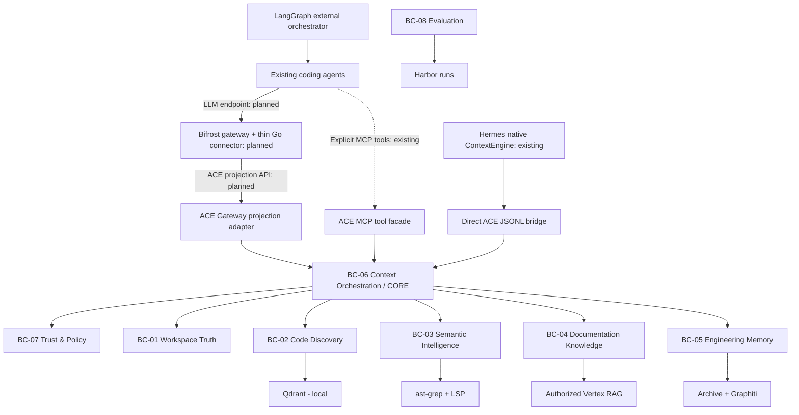

# ACE — Strategic DDD: поддомены, Bounded Contexts и Context Map

**Статус:** Proposed Architecture v1.0 · **Дата:** 2026-10-17 · **Основание:** PRD v1.0 и ADR-000…ADR-010.

> В этом документе `Accepted` относится **только к решениям из исходных ADR**. Границы Bounded Context, порты, имена событий, технические интерфейсы и модули ниже — **предложенный дизайн**, требующий design review. **Один Bounded Context не означает отдельный pod или микросервис.**

## 1. Domain vision и ценностное предложение

**Current architecture (ADR-016/017, 2026-10-24):** LangGraph or another external orchestrator owns agent coordination. For agents supporting configurable LLM endpoints, Bifrost is the **selected future model-bound context delivery path** through a thin Go connector and versioned ACE projection API; implementation and provider-wire conformance are **not yet complete**. Hermes already has a native ContextEngine bridge. MCP remains a separate existing **explicit tool-call interface**, not mandatory for context injection.

**Adaptive Context Engine (ACE)** — внешний агентонезависимый слой для coding-агентов (включая управляемых LangGraph), который по смысловому запросу поставляет релевантный, текущий, проверяемый и при необходимости исторический контекст. Продукт не пишет код самостоятельно, не управляет скрытой памятью Codex и не заменяет инструменты coding-агента.

**North Star:** `end-to-end baseline total tokens / ACE total tokens >= 5` на заранее зафиксированном наборе задач при качестве не ниже baseline. 5× — цель, а не уже достигнутый результат. Отдельно измеряются денежная себестоимость, latency, фактические ошибки и долговременная память. Цифры публикуются с конфигурацией и ограничениями.

**Две задачи бизнеса:** (1) эффективнее собственная агентная разработка; (2) воспроизводимый DevOps/AI Platform Engineering проект для демонстрации внедрения готовых технологий и доказательных сравнений.

## 2. Ubiquitous Language

| Термин | Строгое значение / антипример |
|---|---|
| `Workspace` | Логически зарегистрированный локальный репозиторий/рабочее дерево; не синоним Git commit. |
| `WorkingTreeVersion` | Идентификатор текущего снимка наблюдаемых исходников, включая изменения вне коммитов; не обещает атомарного снимка всего ФС. |
| `SourceEvidence` | Ссылка на конкретный исходник, хэш, диапазон и метод получения факта. Не означает доказанную корректность программы. |
| `Candidate` | Релевантный результат поиска; может оказаться ложным, устаревшим или неразрешённым. |
| `VerifiedCurrent` | Проверена идентичность наблюдаемого содержания в момент проверки. Не гарантия отсутствия последующей конкурентной правки. |
| `SemanticFact` | Определение/тип/reference из live language service в пределах его модели языка. |
| `UnknownDynamicEdge` | Связь, потенциально скрытая DI/reflection/dynamic dispatch/runtime; отсутствие references не доказывает отсутствие вызовов. |
| `ContextRequest` | Авторизованный запрос на контекст из native/gateway adapter либо явного MCP tool call; не обязательно MCP. |
| `RetrievalPlan` | План обращения к одному/нескольким источникам; Jev пока исследовательский кандидат. |
| `ContextBundle` | Набор evidence, excerpts, отношений и предупреждений с disclosure-ссылками; не patch и не сохранённый файл. |
| `SessionEpisode` | Неизменённый фрагмент оригинальной сессии Codex с provenance и временными метками. |
| `DecisionRecord` | Извлечённое/подтверждённое архитектурное решение с temporal status; не равно свободной LLM-summary. |
| `BenchmarkRun` | Единичное выполнение конкретной конфигурации агента на pinned task/environment. |
| `EvaluationSuite` | Версионированный набор задач, в том числе holdout, предназначенный для сравнения. |
| `PolicyDenied` | Запрещённая операция (включая передачу приватного кода в облако); не обычная ошибка backend. |
| `TechnicalDegradation` | Недоступность разрешённого источника; допустим безопасный fallback Codex с явной пометкой. |

## 3. Поддомены и приоритеты

| Поддомен | Тип | Ответственность |
|---|---|---|
| **Context Orchestration** | **Core** | Из задачи получить стратегию поиска, объединить факты, пометить неизвестное, уменьшить лишний контекст и сохранить lossless drill-down. |
| **Workspace Truth & Freshness** | **Core / supporting** | Проект, версия текущего рабочего дерева, инвалидация stale evidence, правдивость «текущего» кода. |
| **Temporal Engineering Memory** | **Core** | Спустя недели восстановить что, когда и почему обсуждали, не потеряв первоисточник. |
| **Code Discovery** | Supporting | Находит кандидатов через локальный Qdrant и lexical search, но не утверждает семантическую точность. |
| **Semantic Code Intelligence** | Supporting | AST, LSP, definitions, refs, types, structural queries и ограниченность статического анализа. |
| **Documentation Knowledge** | Supporting | Поиск в разрешённых документах через Vertex AI RAG Engine. |
| **Trust & Data Policy** | Generic / critical | Разрешения, data residency, secret filtering, fail-closed решения, безопасное журналирование. |
| **Agent Access** | Generic / interface | Planned Bifrost projection, existing native Hermes bridge, and separate explicit MCP tools. |
| **Experimentation & Evaluation** | **Core для продукта/портфолио** | Harbor, воспроизводимые сравнения, реальный usage, качество, статистика. |

## 4. Bounded Contexts (BC)

**BC-01 Workspace Truth**: хранит идентичность workspace, рабочую ревизию и сведения о свежести. Внешний контекст не изменяет индекс Qdrant напрямую. Выдаёт версионированные `WorkspaceChanged`, `SnapshotObserved`.

**BC-02 Code Discovery**: строит symbol-aware индекс в Qdrant, использует локальный lexical fallback; владеет `IndexGeneration`, retrieval candidates, но не определением «семантически корректно».

**BC-03 Semantic Intelligence**: Tree-sitter/ast-grep + LSP adapter; выдаёт проверяемые структурные и семантические свидетельства. Выбор Serena vs tsserver остаётся spike.

**BC-04 Documentation Knowledge**: адаптер к Vertex AI RAG Engine и версии документов; хранение оригиналов и разрешений на внешний импорт — предмет интеграции, не собственность Codex.

**BC-05 Engineering Memory**: неизменяемый архив исходных эпизодов + Graphiti как temporal index; не превращает извлечённые summaries в принятые ADR без подтверждения.

**BC-06 Context Orchestration**: главный доменный контекст: стратегия, parallel retrieval, relevance-first assembly, дедупликация, freshness, provenance, incomplete statuses, lossless expand.

**BC-07 Trust & Policy**: авторизует маршруты данных и операции на границе, защищает от секретов/prompt injection. Не доверяет внешним источникам и embedded инструкциям в коде.

**BC-08 Evaluation**: формирует reproducible experimental record, контролирует baseline и holdout, собирает provider-reported токены. Harbor — runner, а не источник бизнес-истины.

**Agent Access (ACL)** — supporting adapter/module, **не отдельный Core BC**: переводит запросы к отдельным native/gateway projection и explicit MCP tool endpoints во внутренние команды ACE. Bifrost connector — planned, Hermes native и MCP tools — existing. Системные состояния не управляются из model-generated snippets.

## 5. Context Map

### Relationship types / ownership

| Upstream (owner) → downstream (consumer) | Отношение | Контракт |
|---|---|---|
| Workspace Truth → Code Discovery / Semantic Intelligence | **Published Language + Domain Events** | WorkspaceId, file hash/revision, mutation sequence; downstream builds own projection. |
| Code Discovery → Orchestration | **Open Host Service + ACL** | CandidateBatch с состоянием индекса; не `verified` по умолчанию. |
| Semantic Intelligence → Orchestration | **Customer/Supplier через query port** | ResolvedSymbol, static edge, diagnostic, completeness warning. |
| Documentation Knowledge → Orchestration | **ACL к внешнему SaaS** | DocEvidence: document_id/version/section, authorisation marker, excerpt. |
| Engineering Memory → Orchestration | **Published Language + ACL** | MemoryEvidence со ссылкой на original episode и статусом решения. |
| Trust & Policy → все внешние I/O | **Conformist to mandatory policy API** | Allowed/Denied + reason code; отсутствие решения = Denied. |
| Context Orchestration → Agent Access | **Published Language** | ContextBundle/Projection with distinct gateway/native model-delivery and MCP tool transports; no Qdrant/Graphiti/Vertex DTO leakage. |
| Evaluation → Harbor | **Anti-Corruption Layer** | Internal BenchmarkRun ↔ pinned Harbor execution/result. |

BC **не** является Kubernetes Deployment. Предложение: один modular-monolith process для собственных модулей + готовые stateful зависимости (Qdrant, backend Graphiti) и внешний Vertex. Не проектировать 8 микросервисов.

## 6. Внешние системы и «переплюнуть»

- Codex native — основной сильный baseline: rg/read/git/test/caching/compaction остаются включёнными.
- Serena — сравнительный LSP/tooling baseline и кандидат адаптера.
- Augment Code Context Engine — сильный коммерческий benchmark, но не обязательный runtime dependency.
- GitNexus / CodeGraphContext — сравнительный graph baseline; не принимать noncommercial компонент в коммерческий продукт без лицензии.
- Qdrant — выбранное локальное code retrieval хранилище (**ADR-003**).
- Vertex AI RAG Engine — выбранный documentation retrieval (**ADR-003**).
- Graphiti — выбранный temporal knowledge index с raw archive (**ADR-005**).
- Harbor — выбранный evaluation harness (**ADR-009**).

**Граница возможностей:** систематическую экономию, correctness, превосходство над конкурентами следует доказать на контрольном наборе. Доменное проектирование само по себе не подтверждает 5×.

## 7. Стратегия интеграции и риски

- **Single logical MCP entrypoint**; адаптеры к провайдерам — ports, не зависимости Domain Model.
- **DDD modules в монолите**: `packages/domain-*` либо модульные директории — решение структуры репозитория будет принято в spike, а не сейчас.
- Внешние вызовы проходят Policy Gate **до** отправки payload и redaction; локальные безопасные поиски доступны при деградации.
- Все внешние результаты — недоверенные данные; RAG snippets и transcript fragments не являются инструкциями.
- Security logs обязательны, полная observability отложена по ADR-010.
- Спроектированное событие обозначает факт для подписчиков, **не требование вводить Kafka/event sourcing**: durable outbox при необходимости и локальный event dispatcher достаточны для модульного монолита.

## 8. Источники требований и непереопределяемые решения

- `docs/references/PRD-v1.0.md`: цели, сценарии, quality gates.
- `docs/references/ADR-001...010`: принятые ограничения; **ADR-006 превосходит старое PRD FR-06 о фиксированном `max_tokens`**. Контекст relevance-first, автоматическая обрезка созданного кода недопустима.
- **Открыто:** Jev vs deterministic router; Serena vs tsserver; embeddings local/cloud; code graph extension; способ K8s-доступа к рабочему дереву; provider для Graphiti extraction и его приватность; детали импорта Codex sessions; точная версия/adapter Harbor.

---

## Architecture correction: Bounded Context is not a runnable provider (proposed, 2026-10-18)

Context Orchestration is accountable for the **observable capability** of delivering current, symbol-specific context via the actual MCP entrypoint. Code Discovery owns candidate retrieval semantics, Semantic Intelligence owns AST spans / language-service facts, Workspace Truth owns local source freshness, and Evaluation owns **attribution** of agent-run token results to real ACE invocations. These ownership lines are useful only if runtime composition actually delegates to each provider when required. A port, value object or mock is an implementation artifact, not a delivered bounded-context capability.

**Dependency direction:** Codex → unified MCP ACL → policy-gated orchestration → selected mature provider adapters → current source verification → ranked bundle. Each provider's native DTO belongs in its own adapter, not domain code. A deterministic fallback is explicitly marked fallback/degraded; it never silently becomes the selected Qdrant/AST/LSP implementation. No new microservice is implied by these boundaries. See proposed ADR-012 and `07-architecture-fitness-contracts.md` for proof requirements.
