# ACE — Event Storming: события, команды, политики и hot spots

**Статус:** архитектурная гипотеза; события и термины не следует считать существующими реализациями. Это текстовый Big Picture → Process Level → Design Level Event Storming, требующий последующей совместной сессии с владельцем. События домена ниже не равны событиям Codex SDK/Harbor.

## 1. Event Storming легенда

- 🟧 **Domain event** — произошло и стало фактом (прошедшее время).
- 🟦 **Command** — запрос на действие (может быть отклонён).
- 🟪 **Policy / process manager** — правило реакций на события.
- 🟨 **Aggregate** — владеет инвариантами и последовательностью изменений.
- 🟩 **Read model** — проекция для поиска/выдачи.
- 🟥 **Hot spot / unanswered question** — требует технической или продуктовой проверки.
- 👤 **Actor** — Codex, владелец, Harbor runner.

Эти цветовые обозначения служат текстовой заменой event-storming-стикеров.

## 2. Big Picture — общий timeline

```mermaid
flowchart LR
  A["👤 Register workspace"] --> B["🟧 WorkspaceRegistered"]
  B --> C["🟧 SnapshotObserved"]
  C --> D["🟧 CodeIndexPublished"]
  D --> E["👤 ContextRequested"]
  E --> F["🟧 RetrievalPlanned"]
  F --> G["🟧 EvidenceCollected"]
  G --> H["🟧 ContextBundleDelivered"]
  H --> I["👤 Codex edits code"]
  I --> J["🟧 WorkspaceChanged"]
  J --> K["🟧 IndexInvalidated"]
  K --> L["🟧 IndexUpdated"]
  L --> M["🟧 SessionArchived"]
  M --> N["🟧 KnowledgeExtracted"]
  N --> O["👤 DecisionApproved"]
  O --> P["🟧 DecisionAccepted"]
```

Параллельная линия: `BenchmarkRunRequested → EnvironmentPrepared → AgentRunCompleted/Failed → UsageCaptured → QualityGraded → ComparisonPublished`. **Ни один из этих event-ов не означает, что Harbor меняет реальный рабочий репозиторий.**

## 3. Event Storming — поток A: регистрация и кодовый индекс

| Актор / trigger | 🟦 Команда | 🟨 Агрегат | 🟧 Событие | 🟪 Реакция | 🟩 Проекция |
|---|---|---|---|---|---|
| Пользователь | `RegisterWorkspace` | Workspace | `WorkspaceRegistered` | Validate path/access, observe HEAD + working tree | Workspaces |
| FS watcher / explicit refresh | `ObserveWorkspace` | Workspace | `SnapshotObserved` / `WorkspaceChanged` | Invalidate impacted hits; schedule reindex | CurrentFileRevisions |
| Index scheduler | `StartIndexGeneration` | CodeIndex | `IndexBuildStarted` | Parse safe files, build symbol-aware vectors | IndexProgress |
| Index workers | `PublishIndexGeneration` | CodeIndex | `CodeIndexPublished` | Atomic switch active generation pointer after coverage check | ActiveIndex |
| Ошибка backend | `MarkIndexDegraded` | CodeIndex | `IndexBuildFailed` | Retain previous index as stale; expose reason, fallback lexical | IndexStatus |

**Invariant A:** После `WorkspaceChanged` старый snippet **не** объявляется `VerifiedCurrent`, даже если Qdrant возвращает его с высоким similarity.

**Concurrency hot spot:** файл может измениться между индексированием, candidate discovery и построением ответа. Решение: проверка хэша при materialization, повторная проверка перед delivery; если повторить невозможно — `changed_during_request`.

## 4. Event Storming — поток B: один context request

| Актор / trigger | 🟦 Команда | 🟨 Агрегат | 🟧 Событие | 🟪 Реакция | 🟩 Проекция |
|---|---|---|---|---|---|
| Codex | `RequestContext` | ContextRequest | `ContextRequested` | Policy check до внешнего I/O | Requests |
| Policy Gate | `AuthorizeContextRoute` | AccessDecision | `RouteAllowed` / `RouteDenied` | Denied → halt path/log; no bypass | SecurityJournal |
| Router | `PlanRetrieval` | ContextRequest | `RetrievalPlanned` | Rule-based default; multi-source; Jev spike | Plans |
| Adapters | `CollectEvidence` | ContextRequest | `EvidenceCollected` / `SourceUnavailable` | Dedup, mark partial | CandidateSet |
| Resolver | `VerifyEvidence` | ContextRequest | `EvidenceVerified` / `FreshnessUnknown` | Live AST/LSP + file hash, uncertainty | EvidenceView |
| Builder | `ComposeBundle` | ContextRequest | `ContextBundleComposed` | Relevance-first, lossless expansion links | ContextBundle |
| MCP adapter | `DeliverBundle` | ContextRequest | `ContextBundleDelivered` / `ContextRequestFailed` | Persist only minimal request metadata if allowed | RequestSummary |

**Invariant B:** `CandidateFound` ≠ `VerifiedCurrent` ≠ `RuntimeProven`. Классы свидетельств сохраняются до ответа агенту.

**Invariant C:** Если 2000 строк кода созданы агентом, ACE не заменяет их усечённым snippet. Возможно компактно ссылаться на байт-в-байт сохранённый артефакт, предоставляя `expand` без потерь; ACE не перехватывает и не переписывает сам patch.

**Hot spots:** не выполняет ли дополнительный router model call работу дороже сэкономленного? Нужно ли группировать docs+memory только для некоторых intent? Исследовать через Harbor, не устанавливать произвольный token cap.

## 5. Event Storming — поток C: инженерная память через недели

| Актор / trigger | 🟦 Команда | 🟨 Агрегат | 🟧 Событие | 🟪 Реакция | 🟩 Проекция |
|---|---|---|---|---|---|
| Codex export adapter | `CaptureSession` | SessionArchive | `SessionCaptured` | Verify digest, dedupe, redact prohibited fields, append original | RawEpisodes |
| Archive | `SealEpisode` | SessionArchive | `SessionArchived` | Queue extraction without mutating episode | ArchiveIndex |
| Extraction worker | `ExtractKnowledge` | MemoryFact | `KnowledgeCandidateExtracted` | Link statement to exact episode/offset | CandidateFacts |
| Пользователь | `ApproveDecision` | DecisionRecord | `DecisionAccepted` | Graphiti index, retain temporal interval and sources | CurrentDecisions |
| Пользователь | `RejectDecision` | DecisionRecord | `DecisionRejected` | Never advertise as current requirement | DecisionHistory |
| Новое подтверждение | `SupersedeDecision` | DecisionRecord | `DecisionSuperseded` | Preserve previous fact and reason | Timeline |
| Пользователь | `DeleteStoredData` | ArchivePrivacyRecord | `DeletionRequested` / `DataErased` | Purge originals + derived index + backups per policy | DeletionAudit |

**Invariant D:** Неподтверждённая LLM-summary не становится `Accepted`. Graphiti — производная проекция; оригиналы остаются проверяемым первоисточником (пока не удалены по запросу).

**Hot spot:** обнаружение/capture Codex sessions не гарантировано на всех версиях. Требуется spike exporter и capability detection; нельзя обещать невидимый перехват чужой истории.

## 6. Event Storming — поток D: benchmark / доказательство 5×

| Актор / trigger | 🟦 Команда | 🟨 Агрегат | 🟧 Событие | 🟪 Реакция | 🟩 Проекция |
|---|---|---|---|---|---|
| Инженер | `FreezeSuite` | EvaluationSuite | `SuiteFrozen` | Pin task manifests, repo commits, private tests | SuiteManifest |
| Harbor | `ScheduleRun` | BenchmarkRun | `BenchmarkRunScheduled` | Allocate isolated environment; reset git tree | RunQueue |
| Runner | `StartAgentRun` | BenchmarkRun | `AgentRunStarted` | Save versions/config/toolset fingerprint | RunState |
| Codex/Harbor | `RecordUsage` | BenchmarkRun | `UsageRecorded` / `UsageUnavailable` | Distinguish incremental vs cumulative snapshots | UsageLedger |
| Grader | `GradeOutcome` | BenchmarkRun | `RunGraded` | Preserve failures/timeouts; no cherry-picking | Results |
| Analyst | `PublishComparison` | ComparisonReport | `ComparisonPublished` | Aggregate paired runs, quality gating, holdout | CV Evidence |

**Invariant E:** Учет токенов не складывает cumulative snapshots или cached/reasoning подмножества второй раз. При неизвестной метрике хранится `unknown`, а не `0`.

**Invariant F:** Фактор 5× нельзя заявлять до замороженного holdout, повторов, невозрастания регрессий и полной отчетности включая внешние расходы.

## 7. Process managers / саги

`WorkspaceReindexPolicy`: реагирует на `WorkspaceChanged`, инвалидирует impacted code evidence, планирует `IndexGeneration`, публикует новую версию **только после** достаточной проверки. Retry идемпотентен по `(workspaceId, generationId, fileHash)`; старый generation не становится автоматически свежим.

`MemoryIngestionPolicy`: `SessionArchived → ExtractCandidate → (approval or proposed) → GraphitiProjection`. Сбой extraction оставляет архив целым и регистрирует retry; idempotency по `(sourceDigest, extractorVersion)`.

`RequestFulfillmentPolicy`: `ContextRequested → Authorized → Planned → ParallelSourceQueries → EvidenceResolved → BundleDelivered`. При частичном техсбое ответ `partial` с missing sources; при policy denial — только блок разрешённой операции, без скрытого cloud fallback.

`BenchmarkRunPolicy`: `SuiteFrozen → RunPrepared → RunStarted → RunFinished → Graded → Recorded`. Все терминировавшие run включаются в отчёт, неуспешные не удаляются.

## 8. Design-level hot spots / открытые вопросы

1. Как безопасно дать pod доступ к незакоммиченным файлам на host, без небезопасного hostPath? (ADR-008 открыт)
2. Какая согласованность filesystem watcher и Git status при конкурентных write/rename/delete/untracked?
3. Serena GPL vs direct tsserver и реальные контракты инструмента? (ADR-004 открыт)
4. Локальные embeddings или разрешённая Vertex embedding-модель, time/cost/recall? (ADR-003 открыт)
5. Откуда Graphiti получает extraction LLM при local-first privacy? (ADR-005 и ADR-007)
6. Jev vs rule router: цена полного workflow, false-negative routes и cloud privacy? (ADR-002)
7. Как именно установленный Harbor отдаёт token usage и как правильно обрабатывать cumulative counters? (ADR-009)
8. Как логировать deny без утечки пользовательского текста? (ADR-007)
9. Нужно ли вообще persistent code graph за пределами AST/LSP? (ADR-004; отдельный эксперимент)

## 9. Команды и события — правила проектирования

- Event именуется **свершившимся** действием; command — намерением.
- У события есть `eventId`, `aggregateId`, `occurredAt`, `schemaVersion`, `correlationId` и source, без больших исходников и секретов.
- Дубли event при retry допустимы; consumer идемпотентен.
- Outbox/event log — внутренний механизм надёжности, **не обязательная Kafka/event sourcing**.
- Если owner/consumer не определены, такой event нельзя молча объявлять обязательным для имплементации.
