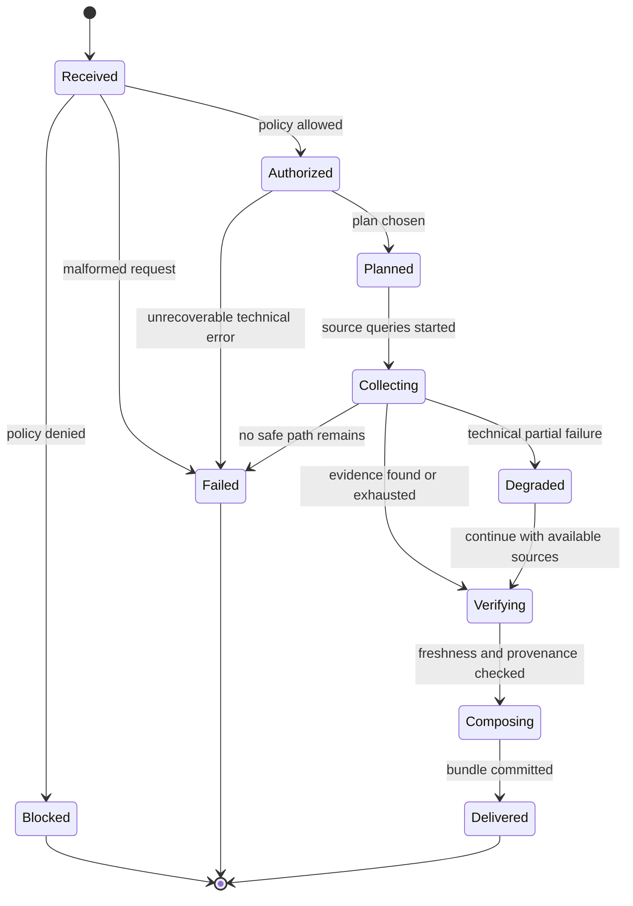
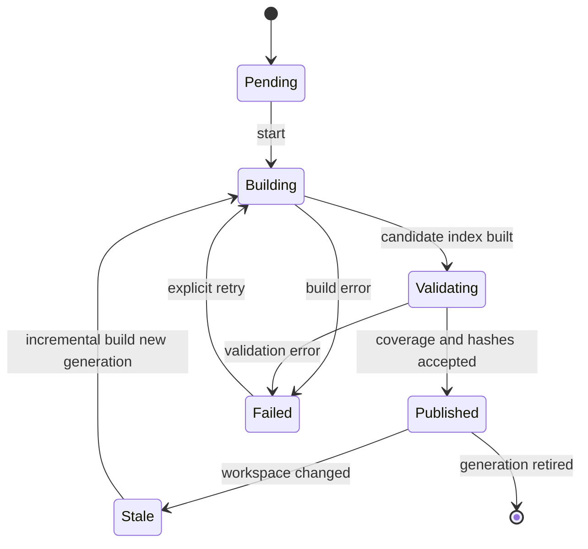
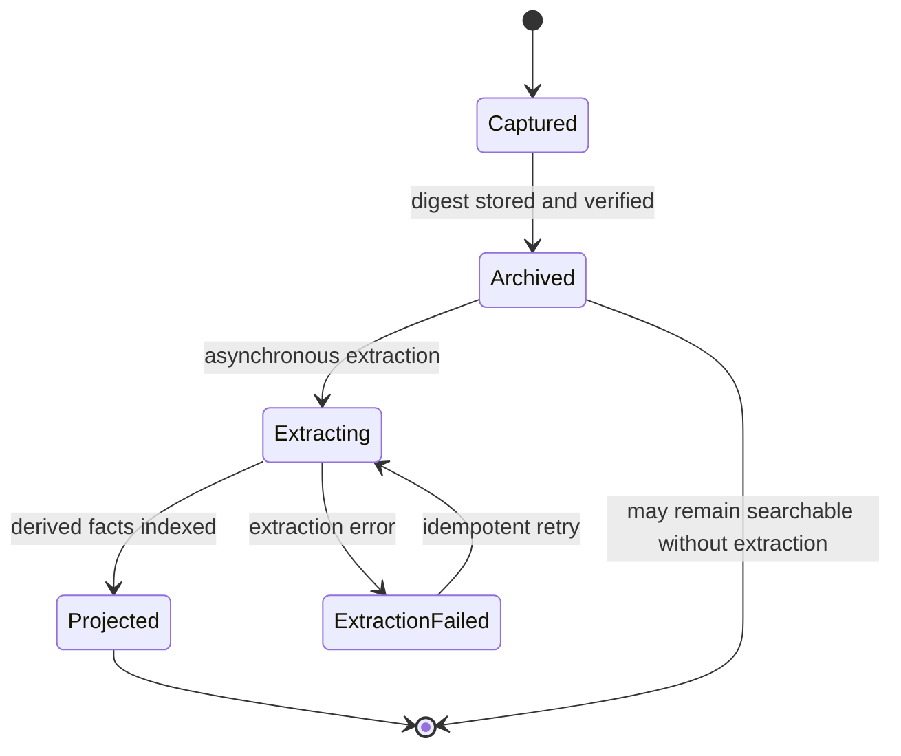
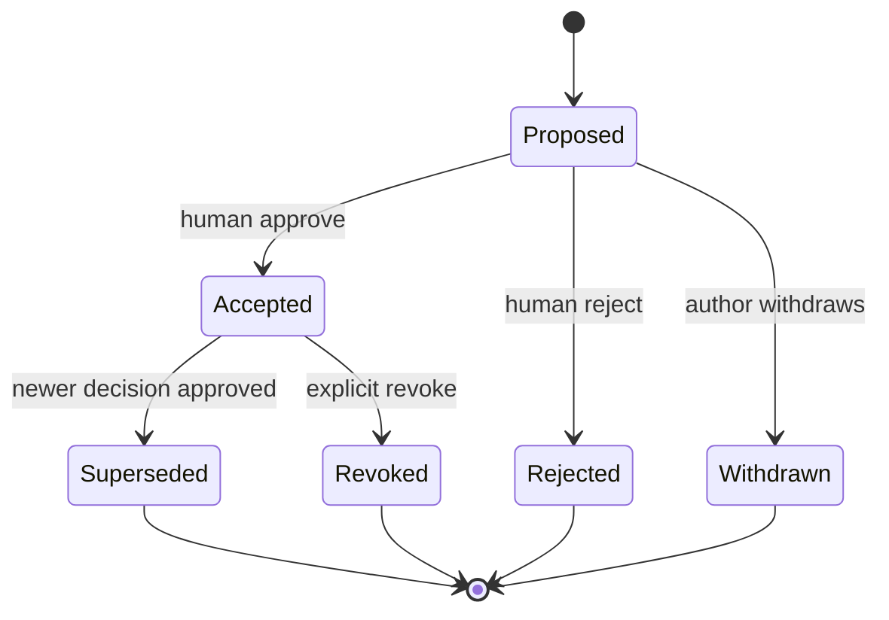
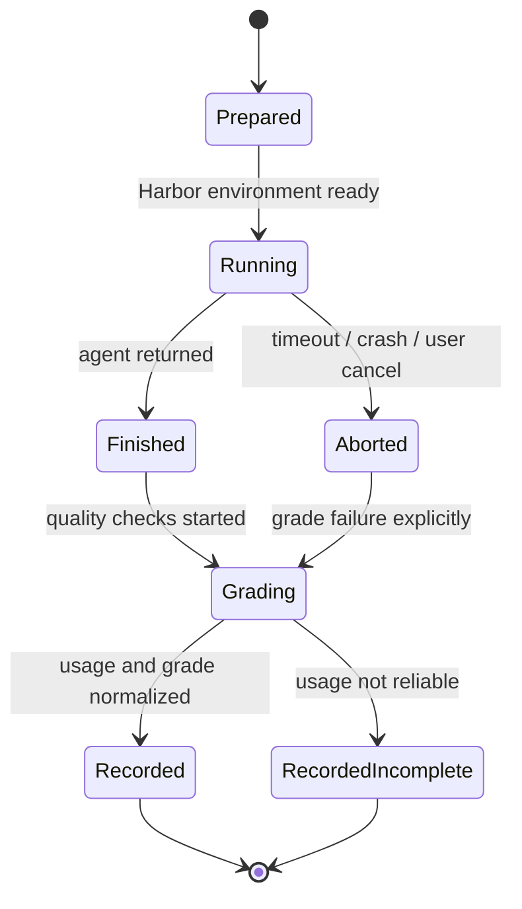

# ACE — FSM и сквозные workflows

**Статус:** Proposed. FSM применяется только там, где порядок переходов защищает инварианты. Роутинг источников по необходимости — decision policy/strategy, **не** state machine. Технология FSM библиотека (например XState) не выбирается автоматически.

## 1. FSM-01: ContextRequest

| Source → event → target | Guard / action |
|---|---|
| Received + `Authorize` → Authorized | Workspace exists; Policy Gate allowed all planned external destinations (may restrict plan). |
| Received + `PolicyDenied` → Blocked | Log safe deny; no prohibited fallback. |
| Authorized + `PlanReady` → Planned | Rule-based strategy initially; multi-route permitted. |
| Collecting + `SourceTimeout` → Degraded | Record missing source, classify as technical only. |
| Verifying + `SourceHashMismatch` → Verifying | Re-read/re-resolve once under retry guard or mark changed-during-request; no false verified state. |
| Composing + `BundleStored` → Delivered | Preserve provenance and full expansion handle. |

**Terminal output classes:** `delivered`, `delivered_partial`, `blocked`, `failed`. `delivered_partial` corresponds to a delivered bundle with explicit warnings; don't fake success.

**Timeout guardrails** are about resources/excessive loops, **not truncating useful files or generated code**. On large results return exact pagination/expansion handles.

## 2. FSM-02: Code IndexGeneration

**Critical:** `Stale → Building` creates a **new** generation; previously published one is not mutated or relabelled `current`. `IndexGeneration` is not the mutable individual file; overlay is evaluated live on read. A pod restart can rebuild persisted projections without loss of workspace identity.

## 3. FSM-03: Session & Knowledge Extraction

**Archive invariant:** extraction status never impacts integrity of raw archive. `Captured` is not accessible as historical evidence until checksum is verified and archived. Explicit deletion/tombstone policy supersedes append-only storage constraints.

## 4. FSM-04: DecisionRecord

`Conflicted` — **ортогональный флаг evidence quality**, не отдельное состояние, так как конфликт может существовать и у принятого решения. `Proposed → Accepted` только явным подтверждением владельца или письменного ADR с доказанным provenance. `Superseded` сохраняет reference на новую принятую запись; нет silent overwrite.

## 5. FSM-05: BenchmarkRun

`Aborted` включён в оценку успешности и стоимость; не удалять этот run. Если usage отсутствует, итоговая запись с `unknown` и причиной, но **не** пригодная для заявления о токеновом превосходстве без оговорок. `Suite` должна быть frozen заранее, а rerun получает новый `runId`.

## 6. Сквозные workflow-спецификации

### UC-01 «Найди retry и почини цикл»
1. Codex обращается к `ace_context(workspaceId, query, intent='behavior')`.
2. Policy Gate разрешает локальный код. Rule router выбирает lexical + local semantic candidates, а документацию добавляет только при соответствующем вопросе/зависимости.
3. Qdrant возвращает кандидатов `sourceDigest`, Tree-sitter/ast-grep выделяют точные spans, LSP разрешает symbols/references на текущей версии.
4. EvidenceMerger отбрасывает дубли, не утверждает полное покрытие динамических вызовов.
5. MCP возвращает `ContextBundle`: выдержки, связи, открываемые exact snippets, предупреждения; Codex сам редактирует файлы, запускает тесты.
6. После патча Workspace Truth фиксирует изменение; stale результаты не становятся verified current. В следующем запросе активируется live overlay.

### UC-03 «Две недели назад обсуждали альтернативу B»
1. Codex `ace_memory_search` по workspace/date/topic.
2. Graphiti temporal index предлагает episode pointers.
3. Raw archive отдаёт оригинальный span и digest, decision timeline даёт статус на запрошенную дату.
4. При конфликте двух извлечений вернуть обе версии, source links и `uncertain`, а не изобрести компромисс.
5. При запрете доступа к оригиналу memory отвечает `restricted`, не подставляет непроверенную summary как точную цитату.

### UC-04 «Файл изменился в процессе retrieval»
1. Candidate из Qdrant указывает digest D1.
2. Live FS показывает D2≠D1.
3. Вернуть код из текущего файла D2, если разрешён/успешно читается; снова разрешить AST/LSP и обновить overlay. Если конкурентная запись продолжается — `changed_during_request` и безопасный retry/неполнота.
4. В ответе **никогда** не маркировать D1 как VerifiedCurrent.

### UC-09 «Vertex недоступен; Auth запрещён»
- Timeout Vertex: source unavailable; локальные разрешённые источники работают; `delivered_partial`/degraded и security-safe journal.
- Forbidden cloud transfer: `blocked` для cloud route; не отправлять в Jev/другой SaaS; возможны только разрешённые локальные маршруты после нового Policy Gate.

### UC-long «Codex создаёт 2000+ строк»
- Code-writing выполняет Codex обычными инструментами. ACE не переписывает его patch и не вмешивается во внутренний compaction.
- Если пользователь/агент запросит полный документ через ACE, он доступен exact bytes либо lossless paging; возвращается checksum, range, continuation marker.
- Test asserts SHA-256 полного артефакта до/после доступа и отсутствие silent truncation.

## 7. Защита от сложной FSM

Не FSM: semantic ranking, vector search, scoring, выбор источника Jev, state of every symbol, динамический call graph. Их поведение лучше моделировать чистыми функциями/ports и event-based invalidation. Реализация автомата предпочтительно typed state + transition table + property tests. Внешнюю FSM-библиотеку подключать только если реальные требования к параллельным/вложенным состояниям её оправдают.
