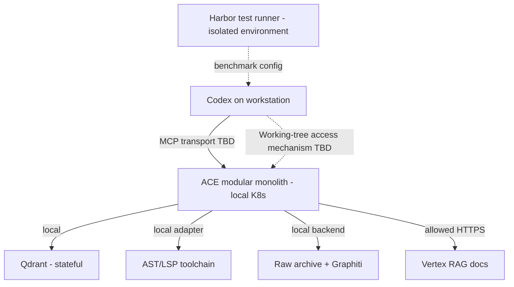

# ACE — Контракты, интеграции и Deployment Sketch

**Статус:** Proposed technical design. Контракты ниже — **логические**, а не обнаруженные API Qdrant/Vertex/Harbor/Codex. При реализации проверить версии библиотек и MCP tool schema. Физический data model и SDK DTO остаются adapter-specific.

## 1. Инварианты границ

1. Unified MCP — единственный логический внешний фасад ACE для Codex; future agent через ACL.
2. Выполнение кодовых правок и контроль Git остаются за Codex; ACE **read-only** относительно файлов проекта (кроме своих индексов/архивов).
3. Порты не импортируют типы Qdrant/Vertex/Graphiti в домен.
4. `RepoPath` не может выйти из разрешённого root после canonicalization (включая symlinks).
5. Любой outbound cloud request авторизован до отправки и относится к конкретной policy version.
6. Все большие оригиналы доступны без потерь; handles должны быть неугадываемыми/access-scoped и протухать/перепроверяться.
7. Evidence provenance и certainty сохраняются в каждом переходе; LLM-generated summary не становится `source`.

## 2. MCP Tool Surface (предлагаемые имена)

| Tool | Аргументы | Результат | Контроль |
|---|---|---|---|
| `ace_context` | `workspace_id`, `query`, optional `intent`, `include_docs`, `include_memory` | `ContextBundle` | Один composite запрос; policy + freshness + provenance |
| `ace_expand` | `bundle_id`, `evidence_id`, optional byte/range cursor | Lossless artifact/content slice, checksum, next_cursor | Не silent truncate, авторизовать повторно |
| `ace_memory_search` | `workspace_id`, `query`, optional `as_of`, `include_original` | Episodes + decision timeline + primary refs | Только доступные/подтверждённые категории |
| `ace_workspace_status` | `workspace_id` | observed epoch, index freshness, incomplete sources | Не объявлять stale индекс текущим |

`ace_context` должен быть достаточным для common tasks. Специальные инструменты drill-down не заменяют свойство unified retrieval. API MCP проходит schema validation; подсказки в тексте выдачи не могут вызвать произвольные операции.

## 3. Версионированный ContextBundle (draft contract)

```ts
// Логический contract v1; реальные schema файлы генерируются в коде.
type Freshness = 'current' | 'stale' | 'unknown' | 'changed_during_request';
type ConfidenceKind = 'static-resolved' | 'static-possible' | 'runtime-observed' | 'not-established';
type SourceKind = 'code' | 'documentation' | 'memory' | 'test';
type Completion = 'complete-within-scope' | 'partial' | 'unknown';
interface EvidenceV1 {
  evidence_id: string;
  source_kind: SourceKind;
  workspace_id: string;
  source_ref: string; // canonical path, doc pointer, episode pointer
  revision_or_digest: string | null;
  range?: { start: number; end: number; unit: 'byte' | 'line' };
  symbol_key?: string;
  method: string; // e.g. qdrant-candidate, ast, lsp, graphiti
  freshness: Freshness;
  certainty: ConfidenceKind;
  excerpt?: string; // never sole storage for original
  expand_handle?: string;
}
interface ContextBundleV1 {
  schema_version: 1;
  request_id: string;
  workspace_id: string;
  outcome: 'delivered' | 'delivered_partial';
  completion: Completion;
  evidence: EvidenceV1[];
  warnings: Array<{ code: string; source?: string; detail?: string }>;
  omitted_sources: string[];
  next_actions?: Array<{ kind: 'expand' | 'verify' | 'test'; ref: string }>;
}
```

**Это минимальный shape, а не финальный TS SDK контракт.** Полное содержимое исходного файла сохраняется в исходном workspace/archive; excerpt — необязательная компактная проекция. `line`/`byte` и charset должны быть определены однозначно в adapter, не смешиваться.

## 4. Domain Ports (proposal)

```ts
interface WorkspaceSnapshotPort {
  observe(workspaceId: string): Promise<WorkspaceObservation>;
  readVerified(ref: SourceReference): Promise<VerifiedRead | ChangedDuringRead>;
}
interface CodeCandidatePort {
  query(input: CodeQuery, snapshot: WorkspaceObservation): Promise<CandidateBatch>;
}
interface StructuralAnalysisPort {
  extractSymbols(ref: SourceReference): Promise<StructuralEvidence[]>;
}
interface SemanticAnalysisPort {
  definition(ref: SymbolRef): Promise<SemanticEvidence>;
  references(ref: SymbolRef): Promise<SemanticEvidence[]>;
  diagnostics(workspaceId: string): Promise<DiagnosticEvidence[]>;
}
interface DocumentationPort { search(query: string, scope: DocScope): Promise<DocEvidence[]>; }
interface MemoryPort { search(query: MemoryQuery): Promise<MemoryEvidence[]>; }
interface PolicyPort { authorize(action: PolicyAction): Promise<AccessDecision>; }
interface ArtifactPort { storeExact(bytes: Uint8Array): Promise<ArtifactRef>; readExact(ref: ArtifactRef): Promise<Uint8Array>; }
```

Возвращаемые `Evidence` проверяются policy/scopes; конкретные interfaces DTO и errors должны быть зафиксированы в `src/contracts/` в ходе SDD-implementation.

## 5. Error taxonomy и fail policy

| Code | Type | Результат |
|---|---|---|
| `POLICY_DENIED` / `AUTH_REQUIRED` / `SECRET_DETECTED` | security | fail-closed; safe audit, никакого обходного SaaS |
| `BACKEND_TIMEOUT` / `PROVIDER_UNAVAILABLE` | technical | degrade, source status, безопасные разрешённые инструменты |
| `INDEX_STALE` | freshness | не current, read-through/re-resolve, при неудаче unknown/stale |
| `WORKTREE_RACED` | concurrency | retry restricted или partial, exact source not guaranteed current |
| `SYMBOL_UNRESOLVED` | semantics | no false semantic relation, fallback candidate only with warning |
| `EXTRACTION_FAILED` | memory | archive intact, derived graph unverified, retry |
| `USAGE_UNAVAILABLE` | evaluation | benchmark record incomplete, not a fabricated 0 |
| `TOO_LARGE_FOR_INLINE` | presentation | exact pagination/handle, never content loss |

Security logs: `occurred_at, correlation_id, component, category, policy_version, outcome`, без секретов, полного промпта и source snippets. Full observability platform по ADR-010 отложена.

## 6. Sync / async boundaries

**Sync within MCP request:** workspace/policy check, retrieval planning, candidate fetch, live hash check, selective AST/LSP resolve, merge and bundle delivery. При конфликте файлов состояние маркируется.

**Async outside request:** index construction/refresh, session import, Graphiti projection, Harbor run aggregation. Event retry idempotent; не ждать Graphiti ingestion во время каждого `ace_context`.

**No global distributed transaction:** local outbox + recheck invariants at delivery, rather than pretending that Git, Qdrant, Graphiti and Vertex commit atomically.

## 7. Предлагаемый deployment topology (не утверждённый mount дизайн)



- **Deployment choice accepted:** existing local Kubernetes, modular monolith (ADR-008).
- **Not yet chosen:** workspace-to-pod access mechanism (`hostPath` vs CSI vs local helper protocol); this **MUST** be spiked, not invented by the agent. Security and live working-tree semantics are acceptance criteria.
- Qdrant/Graphiti backend may require separate stateful Pods. Это зависимости продукта, не дробление домена на микросервисы.
- Не включать OTel/Grafana/Prometheus/enterprise multi-tenant cluster без отдельного решения.
- Harbor может использовать Docker/other supported environment provider отдельно от K8s. Не обещать встроенную поддержку Kubernetes у установленной версии Harbor.

## 8. Data Classification и external services

| Данные | Локально by default | Облако |
|---|---|---|
| Private source code, uncommitted changes | Да | Только project-level opt-in для embeddings; индекс Qdrant остаётся локальным |
| Allowed architecture documents | Кэш по необходимости | Vertex RAG по policy |
| Original Codex conversations | Да | Cloud extraction только после opt-in и secret redaction |
| Security/auth failure logs | Safe local metadata | Не отправлять private payload |
| Benchmark public task metadata | Да | Только явные разрешённые endpoint-и |

## 9. Versioning и migrations

- `ContextBundle.schema_version` и domain events имеют версии; backward compatibility tests для MCP tool consumers.
- Индекс содержит `embeddingProfileVersion`, `parserVersion`, `repo revision` и `generationId`; смена профиля требует нового generation.
- История Graphiti extraction версионируется; смена extractor не меняет raw archive, только derived projection.
- Test fixtures/Harbor/Codex/provider model versions замораживаются в run manifest.

## 10. Технологическая граница

По ADR-011 основной runtime ACE — **TypeScript + Effect**. Effect Schema
обеспечивает runtime validation на границах, а domain/application modules остаются
в одном модульном монолите. Rust допускается только как измеряемая реализация
CPU/memory-heavy code-intelligence операций; Python остаётся внешней границей для
готовых Graphiti/Harbor компонентов. Язык не определяет deployment boundary.

## 11. Open questions / spikes до продакшн-интеграции

1. `SPIKE-K8S-WORKTREE`: способ безопасного доступа к изменяющимся файлам с Codex host.
2. `SPIKE-LSP`: Serena vs tsserver; лицензия, latency, contract, на same tasks.
3. `SPIKE-EMBED`: local vs cloud embeddings; opt-in, quality, metadata schema.
4. `SPIKE-CODEX-SESSION`: возможность точного capture/import оригинала и replay.
5. `SPIKE-GRAPHITI`: подходящий local-first extraction/model backend, storage durability, privacy.
6. `SPIKE-HARBOR`: installed CLI/task schemas, Codex agent adapter, provider-reported usage correctness.
7. `SPIKE-JEV`: только сравнительный routing эксперимент с deterministic rule baseline.
