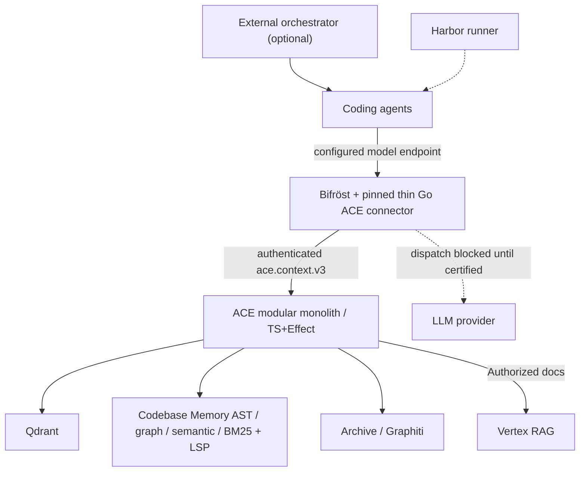

# Bifröst single-Gateway contracts and ACE context RPC deployment

**Статус:** Native Responses/Gateway baseline from 2026-11-18; native code-intelligence wiring was migrated in PR #316. See [source-inspected current architecture](../../operations/current-architecture.md). Older ast-grep/RepoMap and Qdrant-only target sections remain dated design history, not current source. Domain contracts remain provider-neutral; native Responses Gateway v2 public wire is TypeSpec-owned and concrete provider DTOs remain adapter-specific.

## 1. Инварианты границ

**Current architecture (owner decisions 2026-11-14/18):** participating coding agents use Bifröst as their configured model endpoint and native Responses is the only supported provider protocol. A pinned thin Go connector calls the authenticated local `ace.context.v3` Projection API; ACE Core remains TypeScript + Effect. Provider dispatch remains fail-closed; no Hermes-native or model-invoked ACE context route exists as an alternative. Provider-wire and real-agent acceptance are separate G11 evidence.

1. **Одна agent-facing плоскость:** model-bound context проходит только через Bifröst → authenticated ACE context extension Projection API (ADR-017 / OpenSpec 010). LangGraph может планировать агентов снаружи ACE, но не является альтернативным context transport.
2. Выполнение кодовых правок и контроль Git остаются за Codex; ACE **read-only** относительно файлов проекта (кроме своих индексов/архивов).
3. Порты не импортируют типы Qdrant/Vertex/Graphiti в домен.
4. `RepoPath` не может выйти из разрешённого root после canonicalization (включая symlinks).
5. Любой outbound cloud request авторизован до отправки и относится к конкретной policy version.
6. Все большие оригиналы доступны без потерь; handles должны быть неугадываемыми/access-scoped и протухать/перепроверяться.
7. Evidence provenance и certainty сохраняются в каждом переходе; LLM-generated summary не становится `source`.

## 2. Gateway Projection Surface — sole agent-facing delivery

| Endpoint / boundary | Input | Output | Control |
|---|---|---|---|
| `POST /internal/ace-context/v3/project` | native Responses request, session/workspace identity, provider/model, exact body digest+Base64, query, deadline, attestation | `PREPARED` with projected body or `BLOCK` | authenticated loopback caller, strict schema/digest/body identity, policy/freshness; preparation is not send authorization |
| `GET /internal/ace-context/v3/health` | none | liveness, adapter readiness and provider-wire certification state | authenticated loopback caller; liveness is not production readiness |
| `GET /internal/ace-context/v3/capabilities` | none | native Responses route capability and certification state | authenticated loopback caller; unsupported route never becomes implicit pass |
| Bifröst provider-attempt guard | normalized native Responses request + local projection decision | **currently blocks every physical attempt** | no fallback/retry reuse; final-send authorization requires independent certification |

The public agent-facing contract is Gateway-only. Exact source retrieval, memory lookup and expansion remain internal ACE capabilities behind application ports. A model does not choose whether to call ACE.

## 3. Версионированный ContextBundle (draft contract)

```ts
// Логический contract v1; реальные schema файлы генерируются в коде.
type Freshness = 'current' | 'stale' | 'unknown' | 'changed_during_request';
type ConfidenceKind = 'static-resolved' | 'static-possible' | 'runtime-observed' | 'not-established';
type SourceKind = 'code' | 'documentation' | 'memory' | 'test';
type Completion = 'complete-within-scope' | 'partial' | 'unknown';
interface EvidenceV1 {
  evidence_id: string;
  source_kind: SourceKind;
  workspace_id: string;
  source_ref: string; // canonical path, doc pointer, episode pointer
  revision_or_digest: string | null;
  range?: { start: number; end: number; unit: 'byte' | 'line' };
  symbol_key?: string;
  method: string; // e.g. qdrant-candidate, ast, lsp, graphiti
  freshness: Freshness;
  certainty: ConfidenceKind;
  excerpt?: string; // never sole storage for original
  expand_handle?: string;
}
interface ContextBundleV1 {
  schema_version: 1;
  request_id: string;
  workspace_id: string;
  outcome: 'delivered' | 'delivered_partial';
  completion: Completion;
  evidence: EvidenceV1[];
  warnings: Array<{ code: string; source?: string; detail?: string }>;
  omitted_sources: string[];
  next_actions?: Array<{ kind: 'expand' | 'verify' | 'test'; ref: string }>;
}
```

**Это минимальный shape, а не финальный TS SDK контракт.** Полное содержимое исходного файла сохраняется в исходном workspace/archive; excerpt — необязательная компактная проекция. `line`/`byte` и charset должны быть определены однозначно в adapter, не смешиваться.

## 4. Domain Ports (proposal)

```ts
interface WorkspaceSnapshotPort {
  observe(workspaceId: string): Promise<WorkspaceObservation>;
  readVerified(ref: SourceReference): Promise<VerifiedRead | ChangedDuringRead>;
}
interface CodeCandidatePort {
  query(input: CodeQuery, snapshot: WorkspaceObservation): Promise<CandidateBatch>;
}
interface StructuralAnalysisPort {
  extractSymbols(ref: SourceReference): Promise<StructuralEvidence[]>;
}
interface SemanticAnalysisPort {
  definition(ref: SymbolRef): Promise<SemanticEvidence>;
  references(ref: SymbolRef): Promise<SemanticEvidence[]>;
  diagnostics(workspaceId: string): Promise<DiagnosticEvidence[]>;
}
interface DocumentationPort { search(query: string, scope: DocScope): Promise<DocEvidence[]>; }
interface MemoryPort { search(query: MemoryQuery): Promise<MemoryEvidence[]>; }
interface PolicyPort { authorize(action: PolicyAction): Promise<AccessDecision>; }
interface ArtifactPort { storeExact(bytes: Uint8Array): Promise<ArtifactRef>; readExact(ref: ArtifactRef): Promise<Uint8Array>; }
```

Возвращаемые `Evidence` проверяются policy/scopes; конкретные interfaces DTO и errors должны быть зафиксированы в `src/contracts/` в ходе SDD-implementation.

## 5. Error taxonomy и fail policy

| Code | Type | Результат |
|---|---|---|
| `POLICY_DENIED` / `AUTH_REQUIRED` / `SECRET_DETECTED` | security | fail-closed; safe audit, никакого обходного SaaS |
| `BACKEND_TIMEOUT` / `PROVIDER_UNAVAILABLE` | technical | degrade, source status, безопасные разрешённые инструменты |
| `INDEX_STALE` | freshness | не current, read-through/re-resolve, при неудаче unknown/stale |
| `WORKTREE_RACED` | concurrency | retry restricted или partial, exact source not guaranteed current |
| `SYMBOL_UNRESOLVED` | semantics | no false semantic relation, fallback candidate only with warning |
| `EXTRACTION_FAILED` | memory | archive intact, derived graph unverified, retry |
| `USAGE_UNAVAILABLE` | evaluation | benchmark record incomplete, not a fabricated 0 |
| `TOO_LARGE_FOR_INLINE` | presentation | exact pagination/handle, never content loss |

Security logs: `occurred_at, correlation_id, component, category, policy_version, outcome`, без секретов, полного промпта и source snippets. Full observability platform по ADR-010 отложена.

## 6. Sync / async boundaries

**Sync within an authorized Gateway projection:** workspace/policy check, retrieval planning, candidate fetch, live hash check, selective AST/LSP resolve, merge and request-local projection. При конфликте файлов состояние маркируется.

**Async outside request:** index construction/refresh, session import, Graphiti projection, Harbor run aggregation. Event retry idempotent; не ждать Graphiti ingestion во время каждого Gateway projection.

**No global distributed transaction:** local outbox + recheck invariants at delivery, rather than pretending that Git, Qdrant, Graphiti and Vertex commit atomically.

## 7. Предлагаемый deployment topology (не утверждённый mount дизайн)



- **Deployment choice accepted:** existing local Kubernetes, modular monolith (ADR-008).
- **Not yet chosen:** workspace-to-pod access mechanism (`hostPath` vs CSI vs local helper protocol); this **MUST** be spiked, not invented by the agent. Security and live working-tree semantics are acceptance criteria.
- Qdrant/Graphiti backend may require separate stateful Pods. Это зависимости продукта, не дробление домена на микросервисы.
- Не включать OTel/Grafana/Prometheus/enterprise multi-tenant cluster без отдельного решения.
- Harbor может использовать Docker/other supported environment provider отдельно от K8s. Не обещать встроенную поддержку Kubernetes у установленной версии Harbor.

## 8. Data Classification и external services

| Данные | Локально by default | Облако |
|---|---|---|
| Private source code, uncommitted changes | Да | Только project-level opt-in для embeddings; индекс Qdrant остаётся локальным |
| Allowed architecture documents | Кэш по необходимости | Vertex RAG по policy |
| Original Codex conversations | Да | Cloud extraction только после opt-in и secret redaction |
| Security/auth failure logs | Safe local metadata | Не отправлять private payload |
| Benchmark public task metadata | Да | Только явные разрешённые endpoint-и |

## 9. Versioning и migrations

- `ContextBundle.schema_version`, domain events and `ace.context.v3` have explicit versions; the TypeSpec source and generated native Responses contract are checked for deterministic regeneration.
- Индекс содержит `embeddingProfileVersion`, `parserVersion`, `repo revision` и `generationId`; смена профиля требует нового generation.
- История Graphiti extraction версионируется; смена extractor не меняет raw archive, только derived projection.
- Test fixtures/Harbor/Codex/provider model versions замораживаются в run manifest.

## 10. Технологическая граница

По ADR-011 основной runtime ACE — **TypeScript + Effect**. Effect Schema
обеспечивает runtime validation на границах, а domain/application modules остаются
в одном модульном монолите. Rust допускается только как измеряемая реализация
CPU/memory-heavy code-intelligence операций; Python остаётся внешней границей для
готовых Graphiti/Harbor компонентов. Язык не определяет deployment boundary.

## 11. Open questions / spikes до продакшн-интеграции

1. `SPIKE-K8S-WORKTREE`: способ безопасного доступа к изменяющимся файлам с Codex host.
2. `SPIKE-LSP`: Serena vs tsserver; лицензия, latency, contract, на same tasks.
3. `SPIKE-EMBED`: local vs cloud embeddings; opt-in, quality, metadata schema.
4. `SPIKE-CODEX-SESSION`: возможность точного capture/import оригинала и replay.
5. `SPIKE-GRAPHITI`: подходящий local-first extraction/model backend, storage durability, privacy.
6. `SPIKE-HARBOR`: installed CLI/task schemas, Codex agent adapter, provider-reported usage correctness.
7. `SPIKE-JEV`: только сравнительный routing эксперимент с deterministic rule baseline.


---

## Implementation correction — executable composition and proof (proposed, 2026-10-18)

1. **Production bootstrap contract (current implementation correction):** a supported coding-agent model request traverses Bifröst → request-bound ACE context extension Projection → Effect runtime with Codebase Memory as sole AST/graph/semantic/BM25 native engine, plus *currently* Qdrant dense/sparse retrieval and independent LSP verification as needed. Qdrant necessity is under independent CBM-only A/B evaluation, not proved by historical architecture. Vertex and Graphiti are routed only on authorized requests; an unavailable/unapproved provider cannot be reported ready. An adapter existing on disk does **not** satisfy this clause.
2. **Provider truth:** attach `provider_id`, `version`, `status`, `source_digest`, `range`, `evidence_method`, and internal trace/call receipts to every claimed real-provider integration. Runtime receipts may be logged in a secret-safe test channel rather than exposed as user text. Do not silently substitute regex/whole-file candidates for AST spans or hash vectors for embeddings.
3. **Completeness:** compute `complete` from the **required** retrieval plan (covered/failed/skipped-by-policy per source) and source verification; a missing required backend makes the bundle partial even when other evidence is current.
4. **Relevance vs losslessness:** first response provides accurate minimal relevant spans without arbitrary mandatory token ceilings; exact full file/2000-line artifact remains retrievable with an authorized handle. Returning every entire file per lexical symbol is a retrieval-quality failure, not compliance with ADR-006.
5. **Failure isolation:** technical retrieval outage can yield explicit partial/not-ready evidence only where Gateway policy permits; security denial and missing request-bound admission are fail-closed. Preserve cancellation, concurrency, Gateway contract compliance and immutable user worktree.
6. **Stage gates:** component/contract tests → pinned native Bifröst plugin build → real-provider integration/provider-wire capture → real coding-agent Gateway E2E → Harbor attribution/quality/cost tests → owner acceptance. Unpassed gates are **not ready**; do not mark them `[x]` via a controlled exception. See `07-architecture-fitness-contracts.md` and OpenSpec `006-production-retrieval-vertical-slice`.


## 12. Accepted hybrid-context contract update — 2026-10-21

ADR-014 supersedes the earlier “dense candidate store + optional extra tools” interpretation with an explicit **multi-layer hybrid Context Engine**. Agent-facing transport is independently fixed by Gateway-only ADR/OpenSpec 010.

### Code retrieval

The following was the **2026-10-21 historical target**, superseded as a runtime implementation by PR #316. See [current runtime](../../operations/current-architecture.md). Historical target code path:

```text
ast-grep structural chunks
  -> dense embedding + sparse/BM25 representation
  -> Qdrant dense+sparse prefetch
  -> provider-native RRF fusion
  -> optional evidence-approved local reranker
  -> exact current-source verification
  -> maintained LSP enrichment
  -> ContextBundle
```

A separate lexical database is not required by the architecture. Qdrant is the default dense+sparse data plane until benchmark evidence justifies another service.

### Working Context

Future Gateway contract versions MAY carry optional focused/open path/range hints. ACE independently observes authoritative Git/worktree state; hints influence ranking only and never override source digest verification or policy.

### Repeated-context suppression

ContextBundle/evidence identities support repeated-context suppression. A versioned Gateway request MAY present already-known evidence identities; unchanged evidence bodies can be omitted from projection only when compatibility and completeness semantics remain explicit. Exact source remains preserved internally for authorized re-projection.

### Agent independence

No editor-specific state is mandatory. IDE-aware and CLI agents use the same Bifröst model endpoint; richer working-context hints require an accepted Gateway contract extension. See ADR-014, OpenSpec 007 and active Gateway ownership change 010.

**Current ownership:** Hermes sends native Responses only to Bifröst. Bifröst calls ACE over the internal `/internal/ace-context/v3` JSON RPC for source-verified projection and single-use attempt policy; ACE never forwards a model request or starts a competing LLM gateway. Deploy the Bifröst Go plugin and ACE service at the same contract version.
