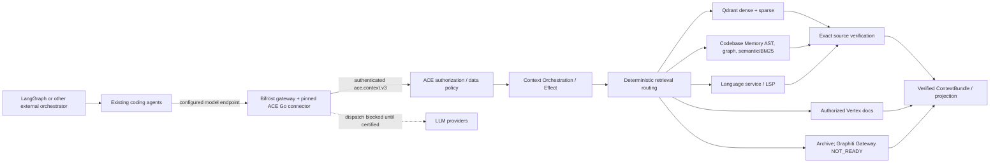

# ACE — Architecture Fitness and Bertrand Meyer Design-by-Contract Gates

**Status:** Accepted Design-by-Contract evaluation policy from 2026-11-14. **2026-11-21 implementation reconciliation:** Native Codebase Memory v0.12.1 replaced runtime ast-grep/RepoMap in PR #316; the current code also composes Qdrant and LSP. The Gateway-native Graphiti provider remains unconfigured, and real provider-wire/Hermes/Harbor acceptance remains open. See [current source-inspected architecture](../../operations/current-architecture.md). Deterministic structural/contract gates are installed; each real-provider/real-agent DBC still requires its own observed evidence before production claims. **Scope:** architecture/spec acceptance, not blanket runtime certification. **Source:** PRD, ADR-001/003/004/005/006/007/009, review `docs/reviews/2026-10-18-architecture-failure-review.md`. Owner acceptance policy approved; implementation and production readiness still require evidence. Existing small unit tests remain valuable but **cannot replace these end-to-end contracts**.

## 1. The architectural mistake we are preventing

> **Integration correction (owner decision 2026-11-14):** Bifröst provider-facing Gateway + ACE Projection connector is the sole agent-facing ACE context path. Hermes-native and model-invoked ACE context delivery are retired. LangGraph or another orchestrator may schedule agents outside ACE. DBC provider/agent evidence must therefore exercise the Gateway route actually under claim.

We chose mature engines for *actual behavior*, but the implementation can satisfy isolated interface/adapter tests while the executable Gateway composition still uses the wrong provider/fallback or never reaches the selected provider. **Port implemented ≠ port injected ≠ provider working ≠ feature delivered ≠ 5× proved**. This document defines observable composition and user-result contracts.

### Runtime component map (production target)



This **does not** require executing every provider for every query. Selection depends on request and permissions. A fallback may exist for outages; it must be labelled as such and cannot silently masquerade as production RAG or LSP evidence.

## 2. Meyer contract vocabulary

For every contract specify `require` (preconditions), `ensure` (postconditions), `invariant` (always true, including after failure), `frame` (what does not change), and `rescue/exception` (typed degraded/denied results). Contracts apply at the **observable Bifröst Gateway/provider boundary** for agent-facing behavior, not just constructors or mocked functions. Internal provider ports remain independently testable but cannot substitute for the Gateway composition they support.

- `require`: validated workspace ID/root, authorized read-only code, pinned source fixture, provider capabilities explicitly approved and reachable for integration tests.
- `ensure`: data actually came from selected, instrumented real provider; correct symbol span and current digest; ranked precise excerpt with citation; full exact originals remain readable from the authorized native host file system with reverified digest. Do not promise an agent-callable expansion command absent from the Native Responses route.
- `invariant`: source truth wins over index projections; semantic edge identity never inferred from name alone; cloud transport gated; raw session source is canonical; all claims truthful and all failures recorded. Deterministic native SHA-256 `createHash` is a pure calculation permitted in domain functions; filesystem, process and platform-I/O imports remain forbidden.
- `frame`: user code and worktree remain byte-identical; no uncontrolled writes or provider calls; benchmark fixtures immutable.
- `rescue`: a technical provider outage may yield an explicitly partial bundle. A policy violation **must not** be bypassed through a fallback.

## 3. High-level executable contract test catalog

IDs are stable acceptance criteria. Each case must be implemented as **agent-facing E2E or real-provider integration test**; pure in-memory test alone cannot satisfy its pass condition.

| Contract | `require` / test fixture | `ensure` / oracle | `invariant` / negative oracle |
|---|---|---|---|
| **DBC-01 Prod composition** | Current candidate: native CBM v0.12.1 + local Qdrant/embedding + required external LSP; supported Native Responses/Bifröst Gateway route active | Trace identifies Bifröst→ACE plus actual invocation of each needed provider for a query requiring them | A disconnected adapter/fallback alone is **not** a passing result; unavailable required providers -> explicit not-ready/partial/block |
| **DBC-02 Symbol precision** | 2000-line TS file with 25-line target function and similar names elsewhere | Answer includes AST-bound target span, correct digest and exact citation; full file is retrievable through the authorized host's exact source reader | Initial excerpt must not copy the full file merely because a symbol name matched |
| **DBC-03 Behavior-based RAG** | Query describes behavior without lexical names; labeled semantic/lexical distractors | Approved semantic retrieval surfaces relevant candidate; hits verified against source; report recall/precision | SHA-256 hash-vector baseline cannot be counted as semantic embedding quality |
| **DBC-04 Same-name semantics** | Classes A/B each implement `save()`; distinct call sites | LSP references/definitions identify correct symbol; tests preserve compiler semantics | Write access is **not** equivalent to definition; name equality is not symbol identity |
| **DBC-05 Freshness race** | Start retrieval on digest D1; mutate file to D2 before response | Deliver D2 after re-read, or `stale/changed_during_request` with evidence | D1 must never be labelled `current`; no TOCTOU falsely current |
| **DBC-06 Failure truth** | Force Qdrant timeout; local AST available | Partial response lists Qdrant as failed; fallback explicitly labelled | `complete=true` prohibited when a **required** source failed, even if remaining evidence is current |
| **DBC-07 Policy safety** | Private-code cloud upload forbidden; Vertex/Jev or an LLM provider requested | Typed `POLICY_DENIED`, audit/evidence record where applicable, **zero** prohibited outbound requests | Gateway private-source projection requires explicit provider identity, cloud opt-in and provider allowlist; do not reinterpret policy deny as outage or auto-route/fallback to another cloud |
| **DBC-08 Source exactness** | 2000+ line code and binary-like UTF-8 payload incl. newlines | Authorized host-side file reads return SHA-256-identical complete bytes (or exact ranges that reassemble them) | Source never silently truncated or replaced with summary |
| **DBC-09 Gateway/connector conformance** | supported native Responses request + pinned Bifröst/connector + explicit provider/model + valid/invalid projection cases | Native Responses v2, auth, honest host-state confidence, request/session binding, pre-retrieval destination policy, secret guard and semantic body preservation meet the accepted contract; physical provider attempts stay blocked until certified | No alternate transport, automatic/unauthorized provider selection, fabricated host transcript proof, unbound attempt, silent passthrough or unpinned plugin ABI |
| **DBC-10 Memory stable identity** | Append one more JSONL episode to already imported history; replay | Prior episode IDs/citations stable; new episode added exactly once | File-level digest change must not re-identify existing episodes |
| **DBC-11 Memory safe deletion** | Two distinct episodes reference identical content digest; delete only one | Survivor remains exactly readable; deleted episode inaccessible; derived projection purged | No shared content removal until reference-safe; no inferred decision auto-accepted |
| **DBC-12 Benchmark attribution** | Pinned paired real-agent runs on a repo/task requiring code exploration | Report prepared-projection count separately from verified final provider sends, provider trace, token totals, quality, external costs and source hashes | A prepared projection without verified provider evidence **cannot** prove ACE-caused saving; trivial forced context injection does not establish value |
| **DBC-13 Index persistence** | Restart ACE with dirty worktree and stale Qdrant generation | Startup/refresh computes truthful index status and incremental rebuild/overlay behavior | Restart never silently upgrades stale generation to current |
| **DBC-14 Documentation conflict** | ADR says X, changed current code says Y | Bundle contains both, source classifications and timestamps, with conflict explicit | Documentation is not silently used as current source-code truth |

## 4. Example formalization: retrieval

```text
ContextRequest.resolve(request, workspace, policy)
  require:
    request is schema-valid
    workspace is registered and authorized
    the real-provider test declares an approved provider set

  ensure (Delivered):
    each evidence item contains verified workspace, path/range/digest,
      source mechanism and freshness status
    needed provider calls are observable and correctly attributed
    selected excerpts have actual AST / LSP boundaries when such claims are made
    full source remains retrievable with an authorized native host source read and independently reverified digest
    complete iff required sources succeeded and evidence checks passed

  ensure (DeliveredPartial):
    all failed required sources and their failure classes are named
    no stale evidence is represented as verified current

  ensure (Blocked):
    policy-denied outbound call count == 0
    a non-sensitive audit record exists

  invariant:
    no write to user worktree
    no invented source or accepted decision
    no silent truncation and no silent provider replacement
```

## 5. Proof and release policy

1. **Unit/contract**: pure domain rules; helper/fixture doubles permitted. Output: `contract-pass:isolated`.
2. **Integration**: real pinned provider and wiring; down/up/outage/race. Output: `provider-pass`.
3. **Agent E2E**: use the actual supported delivery path: real coding agent → Bifröst → ACE context extension → authorized provider. Inspect server-minted physical request binding, normalized session correlation, APPLY/BLOCK receipt, provider-bound evidence, answer/task quality and route identity. Output: `agent-e2e-pass` only for the exact tested route/commit.
4. **Benchmark**: paired Harbor retrieval-demanding tasks; real ACE calls and separate total tokens, costs, success/latency. Output: `evaluation-pass`.
5. **Owner gate**: unresolved provider/license/K8s decisions approved and no outstanding mandatory contracts. Output: `production-ready` only then.

Test result must include: test ID, fixture version/digest, code commit, dependency versions, trace/call evidence, observations, assert results, failed/unknown steps, report links. **Any failed mandatory test blocks readiness.** A documented controlled exception describes a missing capability; it does not pass it. `holdout` must not be tuned against after results.
