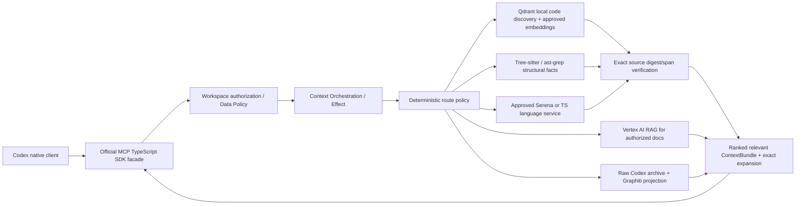

# ACE — Architecture Fitness and Bertrand Meyer Design-by-Contract Gates

**Status:** Proposed correction (2026-10-18). **Scope:** architecture/spec acceptance, not evidence that runtime is ready. **Source:** PRD, ADR-001/003/004/005/006/007/009, review `docs/reviews/2026-10-18-architecture-failure-review.md`. Owner approval required. Existing small unit tests remain valuable but **cannot replace these end-to-end contracts**.

## 1. The architectural mistake we are preventing

We chose mature engines for *actual behavior*, but the implementation can satisfy isolated interface/adapter tests while the executable MCP composes a regex/whole-file lexical fallback. **Port implemented ≠ port injected ≠ provider working ≠ feature delivered ≠ 5× proved**. This document defines observable composition and user-result contracts.

### Runtime component map (production target)



This **does not** require executing every provider for every query. Selection depends on request and permissions. A fallback may exist for outages; it must be labelled as such and cannot silently masquerade as production RAG or LSP evidence.

## 2. Meyer contract vocabulary

For every contract specify `require` (preconditions), `ensure` (postconditions), `invariant` (always true, including after failure), `frame` (what does not change), and `rescue/exception` (typed degraded/denied results). Contracts apply at the **observable agent/MCP boundary**, not just constructors or mocked functions.

- `require`: validated workspace ID/root, authorized read-only code, pinned source fixture, provider capabilities explicitly approved and reachable for integration tests.
- `ensure`: data actually came from selected, instrumented real provider; correct symbol span and current digest; ranked precise excerpt with citation; full exact expansion available.
- `invariant`: source truth wins over index projections; semantic edge identity never inferred from name alone; cloud transport gated; raw session source is canonical; all claims truthful and all failures recorded.
- `frame`: user code and worktree remain byte-identical; no uncontrolled writes or provider calls; benchmark fixtures immutable.
- `rescue`: a technical provider outage may yield an explicitly partial bundle. A policy violation **must not** be bypassed through a fallback.

## 3. High-level executable contract test catalog

IDs are stable acceptance criteria. Each case must be implemented as **agent-facing E2E or real-provider integration test**; pure in-memory test alone cannot satisfy its pass condition.

| Contract | `require` / test fixture | `ensure` / oracle | `invariant` / negative oracle |
|---|---|---|---|
| **DBC-01 Prod composition** | Approved local Qdrant+embedding+Tree-sitter+LSP available; ACE MCP started | Trace identifies actual invocation of each needed provider for a query requiring them | A fallback/index stub alone is **not** a passing result; unavailable providers -> explicit not-ready/degraded |
| **DBC-02 Symbol precision** | 2000-line TS file with 25-line target function and similar names elsewhere | Answer includes AST-bound target span, correct digest and exact citation; full file retrievable on explicit expansion | Initial excerpt must not copy the full file merely because a symbol name matched |
| **DBC-03 Behavior-based RAG** | Query describes behavior without lexical names; labeled semantic/lexical distractors | Approved semantic retrieval surfaces relevant candidate; hits verified against source; report recall/precision | SHA-256 hash-vector baseline cannot be counted as semantic embedding quality |
| **DBC-04 Same-name semantics** | Classes A/B each implement `save()`; distinct call sites | LSP references/definitions identify correct symbol; tests preserve compiler semantics | Write access is **not** equivalent to definition; name equality is not symbol identity |
| **DBC-05 Freshness race** | Start retrieval on digest D1; mutate file to D2 before response | Deliver D2 after re-read, or `stale/changed_during_request` with evidence | D1 must never be labelled `current`; no TOCTOU falsely current |
| **DBC-06 Failure truth** | Force Qdrant timeout; local AST available | Partial response lists Qdrant as failed; fallback explicitly labelled | `complete=true` prohibited when a **required** source failed, even if remaining evidence is current |
| **DBC-07 Policy safety** | Private-code cloud upload forbidden; Vertex or Jev requested | Typed `POLICY_DENIED`, audit event, **zero** prohibited outbound requests | Do not reinterpret policy deny as technical outage; no fallback to another cloud |
| **DBC-08 Source exactness** | 2000+ line code and binary-like UTF-8 payload incl. newlines | Exact range pagination reassembles SHA-256-identical complete bytes | Source never silently truncated or replaced with summary |
| **DBC-09 MCP conformance** | Codex client + official SDK transport, valid/invalid requests | Protocol initialize/list/call/errors/cancel/concurrent requests meet supported SDK/client contract | No hand-rolled production framing without approved ADR and conformance suite |
| **DBC-10 Memory stable identity** | Append one more JSONL episode to already imported history; replay | Prior episode IDs/citations stable; new episode added exactly once | File-level digest change must not re-identify existing episodes |
| **DBC-11 Memory safe deletion** | Two distinct episodes reference identical content digest; delete only one | Survivor remains exactly readable; deleted episode inaccessible; derived projection purged | No shared content removal until reference-safe; no inferred decision auto-accepted |
| **DBC-12 Benchmark attribution** | Pinned paired Codex runs on a real repo/task requiring code exploration | Report actual ACE call count, provider trace, token totals, quality, external costs and source hashes | Zero ACE calls **cannot** prove ACE-caused saving; forced extra tool call on trivial TODO does not establish value |
| **DBC-13 Index persistence** | Restart ACE with dirty worktree and stale Qdrant generation | Startup/refresh computes truthful index status and incremental rebuild/overlay behavior | Restart never silently upgrades stale generation to current |
| **DBC-14 Documentation conflict** | ADR says X, changed current code says Y | Bundle contains both, source classifications and timestamps, with conflict explicit | Documentation is not silently used as current source-code truth |

## 4. Example formalization: retrieval

```text
ContextRequest.resolve(request, workspace, policy)
  require:
    request is schema-valid
    workspace is registered and authorized
    the real-provider test declares an approved provider set

  ensure (Delivered):
    each evidence item contains verified workspace, path/range/digest,
      source mechanism and freshness status
    needed provider calls are observable and correctly attributed
    selected excerpts have actual AST / LSP boundaries when such claims are made
    full source remains retrievable with an authorized handle
    complete iff required sources succeeded and evidence checks passed

  ensure (DeliveredPartial):
    all failed required sources and their failure classes are named
    no stale evidence is represented as verified current

  ensure (Blocked):
    policy-denied outbound call count == 0
    a non-sensitive audit record exists

  invariant:
    no write to user worktree
    no invented source or accepted decision
    no silent truncation and no silent provider replacement
```

## 5. Proof and release policy

1. **Unit/contract**: pure domain rules; helper/fixture doubles permitted. Output: `contract-pass:isolated`.
2. **Integration**: real pinned provider and wiring; down/up/outage/race. Output: `provider-pass`.
3. **Agent E2E**: actual Codex client calls ACE via MCP, answer quality inspected. Output: `agent-e2e-pass`.
4. **Benchmark**: paired Harbor retrieval-demanding tasks; real ACE calls and separate total tokens, costs, success/latency. Output: `evaluation-pass`.
5. **Owner gate**: unresolved provider/license/K8s decisions approved and no outstanding mandatory contracts. Output: `production-ready` only then.

Test result must include: test ID, fixture version/digest, code commit, dependency versions, trace/call evidence, observations, assert results, failed/unknown steps, report links. **Any failed mandatory test blocks readiness.** A documented controlled exception describes a missing capability; it does not pass it. `holdout` must not be tuned against after results.
